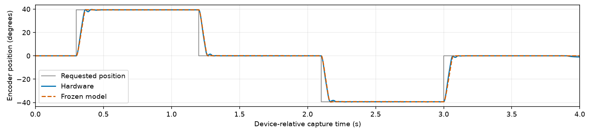

# simmy

## Same PC tuner, simulated and real motor



**Develop and test your control software against a model that behaves like your
machine.** Here, one unchanged PC tuner independently tunes the same production
controller against a frozen SM232AE/TQ10 model and the real motor. The resulting
position responses closely track each other—useful feedback before you get to
the bench, using the same code you'll run there.

[Worked example, fitting context and reproduction commands](docs/axis_controller_development.md).

## Library overview

A small mechatronics simulation library: a serial chain of rigid bodies
connected by compliant (spring + damper + backlash) couplings, a
composable "analog signal chain" standing in for a real DAC/amplifier
signal path, and a bidirectional pulse source for step/dir-style
position commands. It also includes a brushed DC motor, permanent-magnet/BLDC
models with explicit winding/inverter faults and heat accounting, a
voltage-driven 3-phase induction motor (open-loop V/Hz plus two FOC variants),
a current-driven two-phase stepper, and linear electromagnetic actuators --
attraction-only reluctance solenoids and bidirectional voice-coil/moving-magnet
actuators. Mechanical/analog coefficients
and every motor's physical parameters all load from JSON. No opinion on
control algorithms -- you drive it with a plain function pointer, which
may be a three-line demo P loop or a real production control cascade
linked in from somewhere else.

Describe your mechanism in JSON, plug in your controller, and run repeatable
experiments on your laptop or in CI. Start with an example configuration, then
[fit a model to your recordings](docs/characterization_fitter.md) as you bring it
closer to your own machine.

## Why simmy

- **Fast enough to iterate on.** Measured on 2012-era Sandy Bridge
  hardware[^1]: ~200x realtime for basic multi-body mechanical physics
  (`build/three_mass_leadscrew`), ~1.6x realtime for a full electrical
  motor simulation (`build/bldc_faults --case wye_healthy`). No GPU, no
  cluster, and no bench to book.
- **Reproducible in a way a real motor isn't.** No `rand()` anywhere in
  the physics; fixed-step runs are deterministic. A simulated motor
  doesn't drift with ambient temperature, bearing wear, or which bench
  it happens to be wired to today -- the same JSON config gives the
  same answer on your laptop and in CI, every time, and you can hand
  someone the exact motor you tested against instead of a description
  of one. That's what lets a real test suite run against the simulated
  plant on every commit, instead of waiting for hardware time.
- **Validates settling accuracy and autotune behavior without physical
  hardware.** Real production self-tuning firmware (RLS + gain-glide)
  can run, converge and be scored against simulated plants it was never
  shown before -- including plants that deliberately mismatch its
  internal model.
- **No opinion on control algorithms.** A three-line demo P loop and a
  real production control cascade are both ordinary implementations of
  the same function-pointer typedef.
- **Five motor families, one mechanical/analog core.** Brushed DC,
  BLDC/permanent-magnet, 3-phase induction (V/Hz + FOC), stepper, and
  linear electromagnetic actuators (reluctance solenoid + voice coil) --
  roughly simplest to most complex.
- **C compiler + libm only.** No Python, no third-party JSON library for
  the core library and tests; plotting examples are optional.

## Build

```
make lib        # build/libsimmy.a
make test       # plain assert()-based test suite
make examples   # self-contained mechanical and motor experiments
make integration      # OPTIONAL -- only if a ../analog-servo sibling repo exists
make rls-integration  # OPTIONAL -- only if a ../analog-servo-rls sibling worktree exists
```

## Minimal example

```c
SimmyChainParams params;
SimmyChainParamsFromJsonFile("my_config.json", &params, NULL, 0);
SimmyChainState state;
SimmyChainInit(&state, &params);

for (;;) {
  int32_t position = SimmyChainFeedbackPositionCounts(&state, &params);
  int32_t velocity = SimmyChainFeedbackVelocityCounts(&state, &params);
  int32_t torque = my_controller(NULL, target, position, velocity, dtCycles);
  double force = SimmyAnalogChainStep(&analogState, &analogParams, (double)torque);
  SimmyChainStep(&state, &params, force);
}
```

## Full documentation

Built for Read the Docs; see `docs/` (`mkdocs serve` to browse locally):

- Sample parameters and measured results for the
  [brushed DC](docs/motors/dc.md), [BLDC](docs/motors/bldc.md),
  [3-phase induction](docs/motors/induction.md),
  [stepper](docs/motors/stepper.md), and
  [solenoid/linear actuator](docs/motors/solenoid.md) motor models.
- The [loop frequencies](docs/loop-frequencies.md) every example fixes
  (mechanical tick, drive/current/PWM/commutation clocks, plant
  integration rate).
- The [mechanical chain](docs/mechanical-chain.md),
  [analog signal chain](docs/analog-chain.md), and
  [JSON config format](docs/build.md#json-config-files).
- [Driving simmy with your own controller](docs/integration.md) and the
  [scope and non-goals](docs/scope.md) that bound every model here.
- Every [example](docs/examples.md) and its reproduction commands,
  including the hardware-free settling-accuracy/autotune validation.

## License

MIT, see `LICENSE`.

[^1]: Intel(R) Xeon(R) CPU E5-1650 0 @ 3.20GHz.
