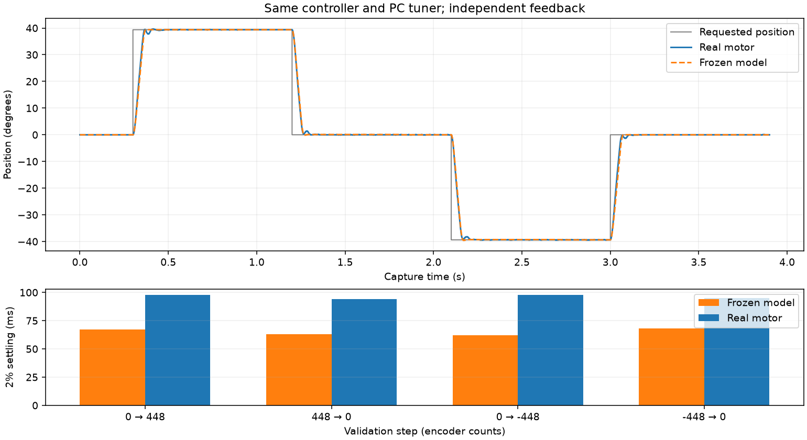

# Controller development in simulation

Run the same control software against simulated and real feedback. On this
SM232AE/TQ10 axis, one unchanged PC tuner independently selected gains for the
same production controller on both backends. The resulting motion closely tracks,
with less than 0.7% overshoot on all four validation steps.

The upper panel shows the controlled portion of the validation recording; the
lower panel makes settling differences visible without repeating a full telemetry
dashboard. No fitted timing shift is applied. The original full record includes
one second of zero-effort postroll, which is not active position holding.

## What actually ran

- The production `analog-servo` cascade, using encoder count differences at 1 kHz.
- The same PC search policy, objective, initial gains and stopping rules on both
  backends. Feedback determines each independent candidate path.
- Frozen empirical command-v2, integrated at 0.5 ms with continuous plant state.
- 53 simulated and 51 hardware trials, including three fresh interleaved repeats
  of each of three finalists, followed by predeclared ±448-count validation.
- An unchanged 3276/32767 effort-code cap, approximately 10% full scale. Codes
  are not calibrated measured current or torque; ADC remained disabled.

| Selected raw Q8.8 gain | Model | Motor |
|---|---:|---:|
| Position P | 20 | 26 |
| Velocity P | 128000 | 120000 |
| Velocity I | 5120 | 15488 |

The selected gains need not be identical for a useful simulated development
workload. This finite search does not identify unique optima: hardware integral
gain is near its search ceiling, and repeated finalist cost ranges overlap.

## What this establishes

The model supports the same tuning/controller workflow and similar controlled
motion in this operating range. It does not establish open-loop plant fidelity:
feedback can correct position while commanding different holding effort.
[Predicting recorded motion](axis_recorded_motion.md) tests that separate question.

The external drive was reported faulted after the search and subsequently
recovered manually. The exact trip time/cause are unknown; the external alarm
was not recorded. Capture integrity is not proof of continuous drive health.
The external alarm is not an input to the captured telemetry; these results
cannot establish continuous drive health or identify that fault's cause.

## Method and evidence

[Reproduce the results offline](identification_reproduction.md). The repository
keeps the frozen model, controller sources, compact comparison metrics and an
archive checksum index; raw recordings stay outside Git. Public archive hosting
is pending. This case uses a separately fitted empirical axis model, not the
generic chain fitter or an electrical winding model.

The reusable tools are `examples/axis_pc_tune.py`, `axis_pc_compare.py` and
`axis_docs_figures.py`. The first runs a backend's own feedback-driven search;
the others read saved results without commanding hardware.
