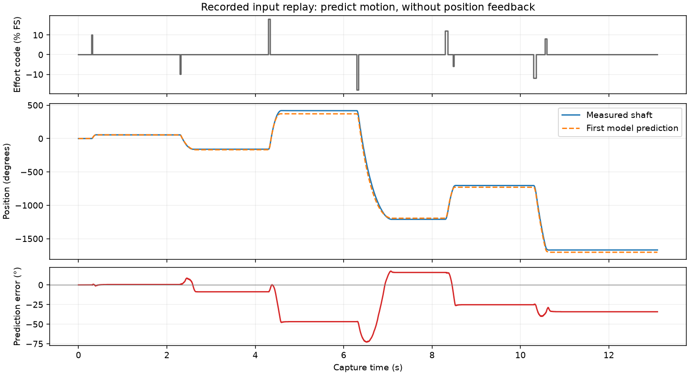

# Predicting recorded motion

Give a frozen model the recorded effort history and ask it to predict encoder
motion without position feedback correcting its mistakes. This tests plant
prediction, not the [independent controller-development workflow](axis_controller_development.md).

This designed six-maneuver recording contains short and longer launches, coasts
and opposing braking commands. The input is uploaded effort code, not measured
current or torque. The model runs continuously through all six maneuvers; the
residual panel shows accumulated prediction error rather than hiding it with
per-move realignment. Only the measured initial encoder origin is removed once.

## Result and operating range

Frozen command-v2 improved the pooled position error across four new captures
from 112.26° for v1 to 35.43°. It passed 20 of 24 predeclared displacement checks
and 20 of 24 peak-speed checks. The remaining low-command errors are meaningful;
this is not a claim that every move passed.

Those recordings were acquired after v2 was frozen, with predictions saved before
START. They have since been inspected for model development and are now **seen
evidence**, not a fresh validation set for a later replacement.

The model uses effective directional command gains, constant/viscous losses,
command filtering and a deadband. It does not identify intrinsic bearing
friction, drive current or an electrical torque offset separately. Low-speed
history effects and return motion remain unresolved.

## Why replay and closed-loop plots can disagree

Suppose the real controller holds the shaft still with a nonzero command. A
model with an inadequate holding-friction law may accelerate under that same
command. When each plant instead has its own closed-loop controller, the
simulated controller can choose a different command and still hold position.

That is why the controlled position overlay and this effort-replay figure answer
different questions. Neither should be substituted for the other.

## Method and evidence

The frozen coefficients and training provenance are in
`models/axis/sm232ae_tq10_command_v2.json`. `examples/axis_command_model_v2.c`
implements batch replay; `axis_command_step.h` provides the matching stateful
kernel for feedback-driven simulation. Neither resets the plant at maneuver
boundaries.

[Reproduction and artifacts](identification_reproduction.md). Generate backtest
arrays with `examples/axis_workload_replay_check.py`, then render them using
`axis_docs_figures.py --replay CASE.npz` alongside the controller comparison.
The plotted first model is frozen v2. Keep the model order and input hashes with
the arrays rather than inferring identity from a similar-looking curve.

A proposed refinement must improve the behavior you need without silently
breaking other operating ranges. Evaluate both short feedback-controlled moves
and longer effort-driven coasts; lower fitting error alone is not promotion.
