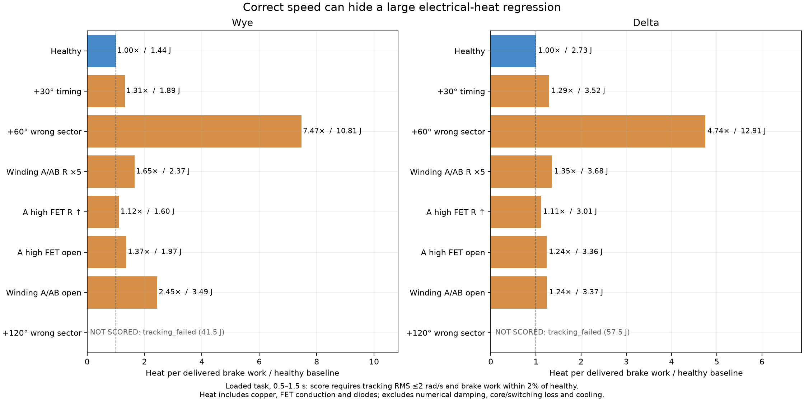

# BLDC faults, electrical heat, and a validated reduced model

## What we have now

Two voltage-driven permanent-magnet model levels share the existing mechanical
chain and SI torque/speed interfaces:

- **`SimmyPmStep`**: inexpensive two-current alpha/beta model for balanced
  healthy windings, sinusoidal or trapezoidal back-EMF.
- **`SimmyBldcVoltageStep` / `SimmyBldcBridgeStep`**: explicit winding branches,
  floating-neutral wye or closed delta, individual winding parameters, and
  a three-leg inverter with channel resistance, surviving body diodes and
  floating-terminal circuit resolution.

Public declarations are in `include/simmy_bldc.h`, also included by
`include/simmy.h`; implementation is `src/simmy_bldc.c`. Parameters currently
use the C API, not JSON. Controllers, PWM timing, fault scenarios and scoring
policy remain examples rather than being embedded in motor physics.

This is an equation-level circuit model, **not calibrated hardware truth**.
There are still important omissions, particularly mutual inductance and
magnetic saturation. Keeping more circuit states does not remove those
model assumptions.

## The physical ports and state equations

All motor inputs/outputs are SI. Angle and speed are **mechanical** radians
and rad/s. For each winding:

```
e_k = k_k(theta_e) * shaft_speed
T   = sum(k_k(theta_e) * winding_current_k)
L_k * di_k/dt = winding_voltage_k - R_k*i_k - e_k
theta_e = pole_pairs*shaft_angle + winding_axis_offset
```

For the sine waveform, `k_k = -Ke_k*sin(theta_e - 2*pi*k/3)`. Trapezoidal
waveforms have flat 120-degree regions and 60-degree ramps; an optional
additional third harmonic is supported. `Ke` is winding-peak back EMF per
**mechanical** rad/s and the corresponding winding torque coefficient in
Nm/A. It is not a datasheet line-line RMS constant or rpm/volt Kv. Do not
multiply by pole pairs a second time. The same coefficient produces EMF
and torque, preserving `T*speed = sum(e_k*i_k)` even if coupling differs
between windings. It also produces finite stall torque without dividing
power by zero speed.

Inductances are constant, independent positive winding inductances. Stored
incremental winding energy is `sum(.5*L_k*i_k^2)`, not the complete spatial
magnetic energy of the motor/magnets. Copper dissipation is
`sum(R_k*i_k^2)`.

Wye branches run A/B/C to a floating neutral. Delta branches run **AB, BC,
CA**. The model solves winding currents and terminal potentials together;
it does not prescribe phase currents or substitute the rotating command
for actual mechanical motion. The example feeds resulting torque through
`SimmyChainStepDt` and `SimmyMotorMount`; no speed/current clipping or extra
mechanical compensation force is used.

## Why wye/delta must be topology, not a gain

Wye winding currents equal terminal currents and sum to zero. Delta obeys:

```
terminal_A = winding_AB - winding_CA
terminal_B = winding_BC - winding_AB
terminal_C = winding_CA - winding_BC
```

Delta has an additional circulating-current mode: equal currents in all
three winding branches cancel at the terminals. Asymmetric windings or
triplen back-EMF harmonics can excite modes that a balanced two-axis
terminal-current model cannot represent.


This electrical bench fixture has an **externally driven shaft at 100
rad/s**, trapezoidal back-EMF and all FETs OFF. Body diodes do not conduct at
this operating point. Terminal currents are zero, but delta accumulates
about **.0708 J of winding heat in .1 s**. Wye accumulates essentially zero.
Mechanical work supplied by the dynamometer pays for that heat and winding
energy. This prescribed-speed electrical test is not a free-rotor controller
assigning itself the desired speed.

An OFF bridge is not generally disconnected: at sufficiently high back EMF
its body diodes rectify and return power to the bus. Tests cover this too.
An open winding and a disconnected motor lead are also different networks;
the implemented static-open fault is a **winding branch opening**, not an
arbitrary lead-disconnection or package-failure model.

Constant-R/L topology is not inherently nonlinear. The diode/switch mode
transitions make the full circuit piecewise linear, and healthy sinusoidal
balanced operation admits useful reductions. Faulted/harmonic operation
cannot generally be captured with a single delta/wye scaling factor.

## The reduced model: exactly where it agrees

For symmetric floating-wye R/L and imposed terminal voltages, applying the
amplitude-invariant Clarke transform gives two current states. The reduced
model uses the projected EMF and torque coefficients, including trapezoidal
wye waveforms. Common-mode EMF shifts the neutral but cannot drive wye
zero-sequence current. Its copper power is `1.5*R*(i_alpha^2+i_beta^2)` and
stored energy `.75*L*(i_alpha^2+i_beta^2)`.

A terminal-equivalent **sinusoidal delta** can also be constructed:

```
R_delta = 3*R_wye
L_delta = 3*L_wye
Ke_delta = sqrt(3)*Ke_wye
winding_offset_delta = offset_wye + pi/6
initial circulating current = 0
```

This is an equivalence construction, **not identical coils simply rewired**.
With the same physical coils, wye/delta ratings and operating points change.
The familiar sqrt(3) voltage/current relationships assume balanced sinusoidal
operation, not arbitrary six-step/harmonic or fault conditions.


The example evolves three independent mechanical trajectories, each with
its own motor state and angle feedback, under the same ideal voltage policy
and load changes. No currents, speeds or applied-voltage recordings are
copied from one model to make another agree. Maximum current discrepancy is
about **9.8e-13 A**. Unit tests also compare torque, winding energy, cumulative
heat and input/work ledgers for sine/trapezoidal wye and equivalent sine
delta, including a blocked common-mode EMF component in wye.

This demonstrates the reduction, not exactness of every healthy shortcut:

- A two-state model has no delta circulating-current state. The harmonic
  delta example above is deliberately outside the equivalence domain.
- An imposed-voltage model alone does not resolve the voltage of a floating
  six-step inverter leg. Use the bridge solver for that conduction question.
- Averaged PWM can omit current ripple and its extra copper heat. The fault
  experiment below resolves actual PWM; it is not validated by equating it
  with a sinusoidal averaged drive.

A local `--benchmark` run of 500,000 identical electrical steps took about
.064 CPU s reduced, .274 s explicit wye and .244 s equivalent delta: roughly
**4x cheaper** in this overlap. This is an illustrative local measurement,
not a portable performance guarantee. Checksums agree; the benchmark's
wall/CPU clock never controls simulated dt.

## Inverter and faults

Each leg requests high ON, low ON or both OFF. ON channels have configurable
resistance and conduct bidirectionally. Body diodes clamp to `-Vf` and
`Vbus+Vf` as necessary; a channel marked open retains its body diode. This
models gate/channel unavailability, not every possible physical FET failure.
The ideal fixed DC bus can both source and absorb energy.

A small active-set circuit solve chooses legal diode conduction modes. It
uses the previous mode as a warm start, then exhausts alternatives if needed.
Floating connected components receive voltage gauges, not artificial leakage
resistors. A floating phase is not hard-grounded or assigned zero current
without solving the winding/diode constraints.

Implemented comparison cases, in **both** connections:

| Case | What changes |
|---|---|
| Healthy | nominal circuit and commutation |
| Timing +30 electrical degrees | commutator timing offset |
| Wrong sector +60 degrees | cyclic lookup offset of one sector |
| High winding resistance | winding A (wye) / AB (delta) R multiplied by 5 |
| High transistor resistance | A high channel .04 -> 1.5 ohm |
| Open high channel | A high FET unavailable; low channel and body diodes remain |
| Open winding | A / AB winding branch open from startup |
| Wrong sector +120 degrees | two-sector offset; wrong-way motion in this fixture |

Opening an energized winding dynamically would need an arc, capacitance or
other energy path. The API **rejects opening a branch with nonzero stored
current**, without mutating state or output, rather than erasing its energy.
A winding shorted turn requires an additional coupled circuit; reducing
phase current or Ke is not an adequate replacement. Shorted-device/shoot-
through currents need DC-link impedance and protection beyond motor L.
Those faults are not implemented.


The phase plots use rotor-angle-binned waveform samples, not pointwise
comparison of separately evolving trajectories. An open high channel loses
one conduction polarity while its low channel still works. An open wye
winding has no current at that terminal; an open delta AB winding can have
zero AB current while terminal A still carries current through the remaining
branches. These are not equivalent 'weak phase' gains.

Signatures aid investigation, but do not uniquely diagnose an actual failed
winding/device without measurements and identified circuit parameters.

## Heat added and regression scoring

Heat accounting is per component, in **joules**, without a temperature claim:

- Winding: integrate `R_k*i_k^2`.
- FET: integrate `Ron*i_channel^2` for each of six devices.
- Diode: integrate `Vf*abs(i_diode)` for each body diode.

Use **winding currents**, not terminal currents, for delta copper heating.
Actual PWM current ripple contributes because electrical currents are
resolved; switching-transition energy, reverse recovery and core loss do
not. Cooling/thermal mass and temperature-dependent resistance remain absent.



The score is heat per delivered passive-brake work, normalized to a healthy
baseline of the **same topology**. It is not a complete electrical efficiency
measurement. This example scores the loaded .5–1.5 s window only, requiring
speed tracking RMS <=2 rad/s and work within 2% of baseline. A >10% increase
is flagged `heat_regression`. These thresholds are example policy, not a
motor safety specification.

| Case | Wye heat | Wye relative heat/work | Delta heat | Delta relative heat/work |
|---|---:|---:|---:|---:|
| Healthy | 1.435 J | 1.00x | 2.725 J | 1.00x |
| +30 degrees | 1.892 J | 1.31x | 3.515 J | 1.29x |
| +60 degrees | 10.806 J | 7.47x | 12.913 J | 4.74x |
| Winding R x5 | 2.371 J | 1.65x | 3.684 J | 1.35x |
| High-FET R increased | 1.603 J | 1.12x | 3.012 J | 1.11x |
| High FET open | 1.968 J | 1.37x | 3.362 J | 1.24x |
| Winding open | 3.490 J | 2.45x | 3.373 J | 1.24x |
| +120 degrees | 41.469 J | NOT SCORED | 57.474 J | NOT SCORED |

All scored cases hold approximately 60 rad/s after settling. **Correct speed
can hide a large heat regression.** The two-sector faults run in the wrong
direction and fail tracking. Their brake still absorbs energy, so work alone
would not establish task success. The guard deliberately prevents treating
failed motion as an efficiency improvement.


A high winding resistance and a high FET resistance heat different components;
we retain their individual ledgers instead of reporting only total loss.
Mechanical friction and the external brake's dissipated work are not counted
as motor/inverter electrical heat.

`bldc_metrics.py` also compares a new summary against a **retained historical
baseline**, not merely today's healthy trial. It is stdlib-only and exits 0
for pass, 1 for heat/tracking/work regressions, 2 for invalid input. Missing
cases or different windows are errors, and invalid baseline tasks cannot
produce a passing score. Comparison still assumes the same physical task
and model assumptions; window/work checks do not replace experiment design.

## Motion experiment and clocks

Illustrative, not identified motor parameters:

- Four pole pairs, each physical winding .6 ohm, .002 H, Ke=.08 peak V/(rad/s).
- 24 V bus, nominal FET Ron=.04 ohm, Vf=.6 V.
- Inertia .0008 kg m^2, viscous drag .0005 Nm/(rad/s).
- Speed request zero until .1 s, ramp 200 rad/s^2 to 60 rad/s.
- Passive .12 Nm brake from .5 to 1.5 s; total duration 2 s.
- Same initial angle .037 mechanical rad in every trial, away from exact
  sector/zero-torque symmetry boundaries. Startup outcomes can depend on
  initial angle; this is not an exhaustive starting-position sweep.

The example PI uses ideal encoder position/speed feedback and fixed nominal
feedforward, not damaged winding/device parameters. It has **no physical
current trip or current loop**. Duty saturation does not guarantee current
protection. The +120-degree cases are unsafe unprotected-drive illustrations,
not hardware experiments to reproduce blindly.


Speed loop: 1 kHz. Sector decisions: 20 kHz. High-side PWM: 5 kHz, with a fixed
5 us digital timing quantum (40 counts/period). The selected low leg stays
ON during PWM off-time, except at zero duty when all gates are OFF.
Electrical/mechanical solver: four substeps per quantum by default, **1.25 us**.
`--steps 8` halves only solver dt; PWM resolution and all controller clocks
remain fixed. Actual subsequent commands can differ as refined trajectories
cross quantization/sector boundaries; this is a hybrid system.

Backward Euler uses held speed and midpoint rotor position, with endpoint
current torque as a first-order coupling approximation. Diode release is
resolved at grid accuracy, not an exact continuous event solution. The
mechanics remain partitioned, not a fully coupled high-order integrator.

## Energy accounting and numerical error

Every electrical step has an explicit balance:

```
input_energy - shaft_work - electrical_heat - change(winding_magnetic_energy)
    = numerical_loss
numerical_loss = sum(.5*L_k*(i_next_k-i_previous_k)^2)
```

Numerical damping is nonnegative and **not labeled physical heat**. The
reduced model uses the matching Clarke-scaled expression. This identity
checks circuit integration and conversion, not the accuracy of omitted
physical losses or mechanical integration. Cumulative CSV rounding leaves
loaded-window residuals around 1e-9 J.

The retained 1.25 vs .625 us two-grid check changes loaded heat by at most
about **.38%** across these 16 cases. Most speed differences are below .23
rad/s; open-wye-winding reaches .46 and the severe wrong-way delta case
about 1 rad/s. Numerical loss at the coarse grid ranges up to about 2.5% of
physical electrical heat. It is separately visible and decreases with
refinement in the independent analytical RL test. Quantized control can
make whole-trajectory differences nonmonotonic, so do not treat two grids
as a universal precision/error bound for fault thresholds.

## Tests and reproducibility

```sh
make test examples test-tools
build/bldc_equivalence > build/bldc_equivalence.csv
build/bldc_equivalence --benchmark > build/bldc_benchmark.csv
build/bldc_circulation > build/bldc_circulation.csv
python3 examples/run_bldc_sweep.py --output build/bldc_faults.csv
python3 examples/run_bldc_sweep.py --steps 8 --output build/bldc_faults_fine.csv
python3 examples/plot_bldc.py build/bldc_faults.csv docs/plots \
    --fine build/bldc_faults_fine.csv \
    --equivalence build/bldc_equivalence.csv \
    --circulation build/bldc_circulation.csv
# Check newly generated healthy results against the retained baseline:
python3 examples/bldc_metrics.py build/bldc_faults_summary.csv \
    docs/data/bldc_faults_summary.csv --case wye_healthy --case delta_healthy
```

The runner defaults to **256 workers, limited only by case count**; `--jobs`
overrides it, `--case` selects subsets. Trials are offline fixed-step C
subprocesses with no cross-trial synchronization. Ordered merged CSV is
byte-identical to `--jobs 1`. Failure preserves the previous output file.

Raw fault CSV mixes 1 ms overview rows and a 5 us waveform window at
1.25–1.29 s. `command_sample` identifies overview rows. Heat/work/tracking
integrals are accumulated at electrical solver rate, not reconstructed
from aliased current samples. The scorer differences cumulative boundary
values, so dense waveform rows cannot bias the score. `gate_*` records
requested gate states, not a claim that an open channel conducted.

Coverage includes analytical RL convergence, reciprocal EMF/torque and stall
behavior, exact reduction and independent coupled trajectories, freewheel
continuity, overspeed diode rectification, hidden delta circulation, static
open branches (all masks/topologies), high winding/device resistance, open
high/low polarity distinction, atomic error/overflow handling, energy
balances, and 3,000 deterministic varied circuit-state property checks.
Coupled tests exercise fault heat under matched work and reject wrong-way
tracking. Python tooling tests cover parallel determinism, malformed/failed
trials, atomic outputs, historical-baseline exit codes and invalid scores.
Both new C suites pass ASan/UBSan alongside the existing mechanical,
stepper and induction regressions.

PNG/SVG figures and compact summary/convergence/benchmark CSVs are retained
under `docs/plots/` and `docs/data/`. Large raw traces stay in `build/`.

## Remaining limits and worthwhile next steps

- Identify actual phase/line R/L/Ke and back-EMF shape; distinguish winding
  from terminal constants and account for connection topology.
- Add mutual inductance / independently identified zero-sequence inductance
  before predicting quantitative delta circulating-current heating.
- Add sensor timing/quantization, real Hall tables/missing transitions, and
  real firmware control adapters when there is a concrete target.
- Sweep initial rotor angle, loads, fault severity and voltage headroom.
- Add thermal dynamics/core/switching losses and realistic device models
  only when a question requires them; current heat is not temperature.
- Model shorted turns, dynamic winding interruption, lead/package opens,
  shoot-through/DC-link dynamics and hardware protection explicitly rather
  than claiming the current knobs simulate those faults.

This milestone gives useful qualitative fault experiments, a fast validated
healthy reduction, and actionable heat-regression metrics. Agreement within
the simulator is still not hardware calibration or a real-world diagnosis.
