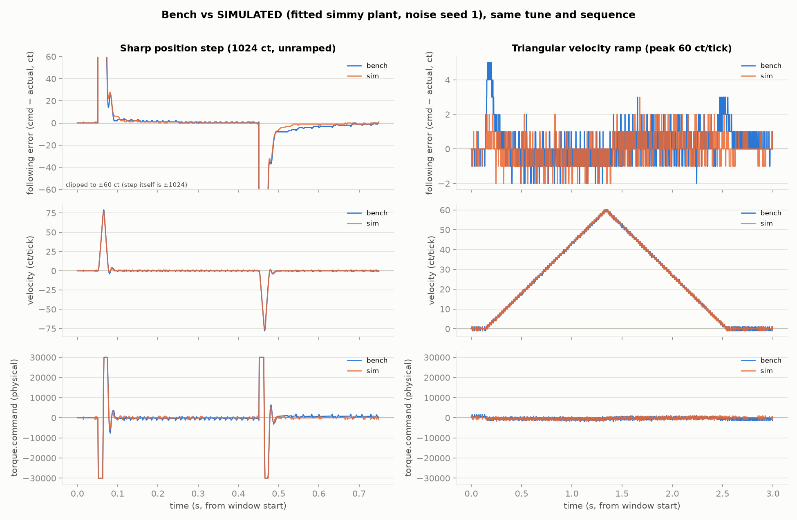
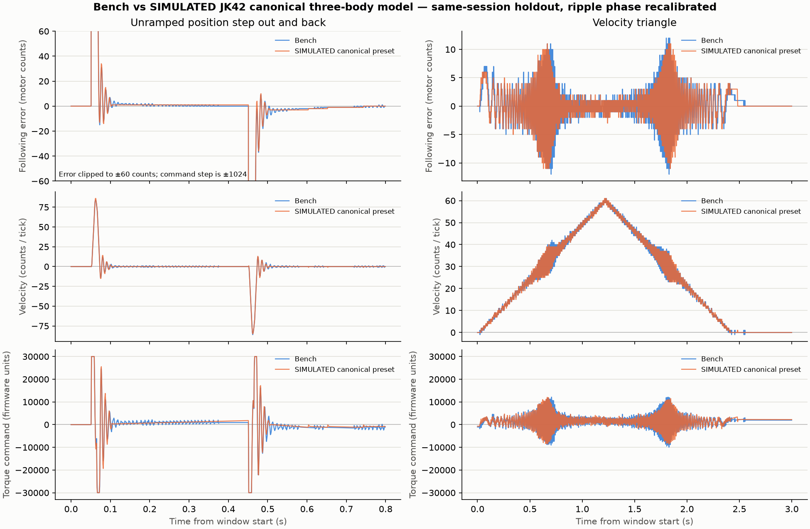

# Bundled models

Use these fitted presets to run your controller against a plant resembling
one of the recorded bench setups. The comparison plots show how closely
the simulated response follows that setup.

By convention, these presets use a 1 ms control tick and firmware
torque-command units, not amperes or N·m. See each model's detail page
for its encoder scale and stepping contract.

These models are fitted to individual bench sessions, not independently
validated machines.

## SM232AE / TQ10, free shaft

A single-body model of an SM232AE motor on a TQ10 drive, with nothing on
the shaft. The analog chain models delay, slew, lag, and noise. The plot
compares the fitting capture with a simulation using the same controller
and command sequence, with noise seed 1.

[Model details and usage](sm232ae_tq10_noload.md).

## JK42 / OEM770T, two-stage gearhead

A three-body model of a JK42 motor on an OEM770T drive with a two-stage
planetary gearhead and no output load. It includes compliant/backlash
links and distributed stiction. The plot compares a same-session holdout
capture with the simulation; only the spatial ripple phase is
recalibrated for its encoder zero.

[Model details and usage](jk42_oem770t_gearhead_noload.md).
