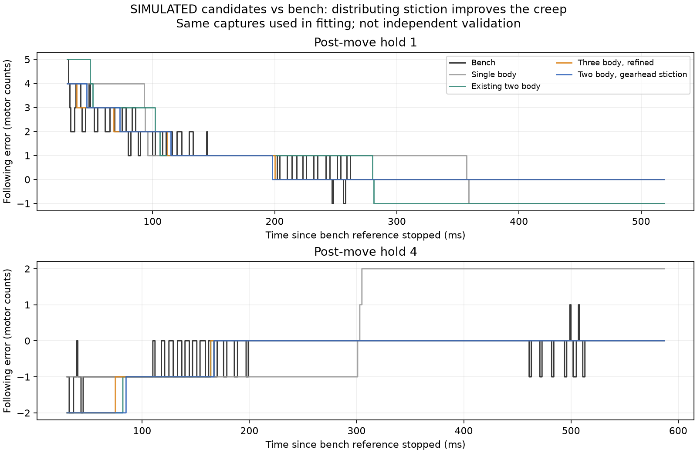

# Bundled models

Use these fitted presets to run your controller against a plant resembling
one of the recorded bench setups. The comparison plots show how closely
the simulated response follows that setup, and where it misses.

!!! warning "Fitted examples, not independently validated machines"
    These models come from one bench session per setup. Their effective
    friction, delay, and compliance parameters are not measurements of
    individual components. Neither preset predicts arbitrary loads or
    guarantees that simulated gains are safe on hardware.

| Setup | Canonical preset | Form | Evidence |
|---|---|---|---|
| SM232AE motor / TQ10 drive, free shaft | `models/sm232ae_tq10_noload.json` | One body; delay, slew, lag, noise | Fitted to one closed-loop step/ramp capture |
| JK42 motor / OEM770T drive / two-stage planetary gearhead, no output load | `models/jk42_oem770t_gearhead_noload.json` | Three bodies; two compliant/backlash links; distributed stiction; delay and lag | Joint fit to moves, torque squares, jogs, and reversals; same-session holdout with recalibrated ripple phase |

Both use a 1 ms control tick and firmware torque-command units, **not
amperes or N·m**. Each preset requires ten analog-chain calls per tick,
with a mechanical `SimmyChainStepDt(..., 0.1)` after each call. Encoder
scales differ; follow the individual model's units and stepping contract.

## SM232AE / TQ10, free shaft

The real firmware controller drives the simulated and recorded plants
through the same unramped position step and velocity triangle. This is
the fitting capture, with noise seed 1, not a held-out validation run.

The preset reproduces the main torque-pulse widths and velocity peaks.
It misses some post-step creep and ramp breakaway, and does not reproduce
current-loop ringing. Other noise seeds change the detailed fit.

[Parameters, use, metrics, and limitations](sm232ae_tq10_noload.md).

## JK42 / OEM770T, two-stage gearhead

The canonical JK42 model has one effective body for the motor and first
sun, one for the first carrier and second sun, and one for the output
carrier. All coordinates are reflected to the motor encoder. It is a
working representation of two planetary stages, not an identified
gearbox drawing.

The comparison below is the same-session `readme_jk` holdout: the older
controller settings and command sequence are replayed unchanged, while
only the spatial torque-ripple phase is recalibrated for its encoder zero.

The refined model gives step overshoots of 14/10 counts versus the
bench's 15/9, and a ramp torque-envelope peak of about 6930 versus 7468.
These agreements do not establish the individual stage parameters.

### Post-move creep

Distributing stiction among the bodies roughly halves the single-body
model's late-hold mismatch: 1.15 to 0.53 counts RMS. A two-body comparison
with gearhead stiction gets nearly the same creep error, so the extra
inertia alone is not the explanation. The three-body model still slips
in discrete steps rather than reproducing all the bench's fine dither.

[Parameters, use, validation checks, and limitations](jk42_oem770t_gearhead_noload.md).

## Other model files

`models/axis/` contains characterization-rig command models with a different
interface and units. They are not interchangeable with these mechanical
chain presets. See the [SM232AE model's comparison of the two interfaces](sm232ae_tq10_noload.md#relation-to-the-frozen-command-v2-axis-model).
