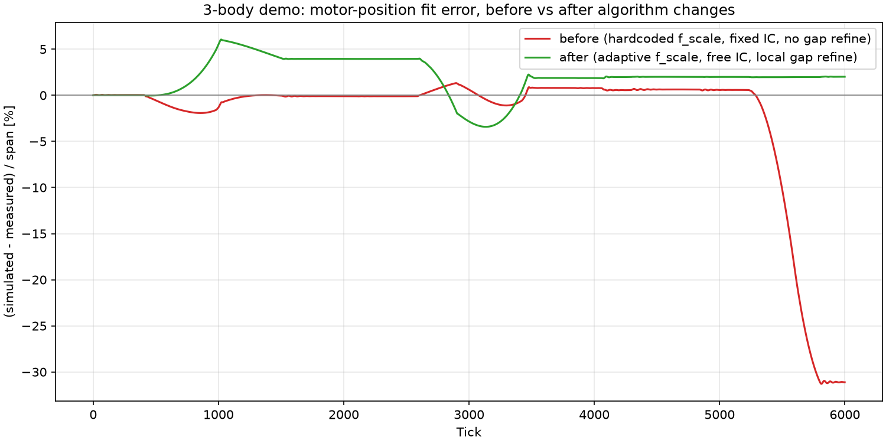

# Quick chain fit

Get a runnable first-pass model from recorded motion: describe the
topology -- *mass <-> leadscrew <-> motor*, with couplings *nut* and
*belt*, say where the encoders are, give rough starting values -- and get
a fitted config back with no further interaction. It reuses simmy's own
data model (`SimmyBodyParams`/`SimmyCouplingParams`/`SimmyChainParams` --
see [build](build.md)) instead of inventing a new one, and drives the real
chain stepper (`SimmyChainStepDt`), not a reimplementation of it.

!!! note "Expanded dependencies, boxed off from the core promise"
    This is the same project, but not the same dependency footprint as the
    rest of it. The core library and test suite are **C compiler + libm
    only** -- that promise is unchanged. `characterization_fitter/` is a
    separate, self-contained directory (own build step, own tests, same
    convention as `characterization_rig/`) that additionally needs NumPy,
    SciPy, and a C compiler to build its own small shared object; nothing
    under `include/` or `src/` changes, and no Python exists anywhere in
    the core library itself. Full details, including why it's laid out
    this way, live in `characterization_fitter/README.md` in the repo.

## Why this exists, and what it isn't

Use this tool for a quick first-order fit before investing in a detailed model.
It fits the selected simmy chain topology, rather than choosing a new model law
for every residual. Start with known values fixed and a small set of free
parameters, then test the output on another recording.

The [measured SM232AE/TQ10 example](axis_controller_development.md) illustrates
controller development with a separately identified empirical model. It is not
an output of this generic fitter. Purpose-specific model refinement and that
bench experiment live in their own pages, not in this usage guide.

## The fit-spec: a strict superset of simmy's own config

A fit-spec JSON mirrors `bodies`/`couplings`/`feedbackBody`/`subSteps`
field-for-field from the format [build](build.md#json-config-files) already
documents. Any leaf field is either a plain number (**fixed**, used as-is)
or `{"guess": g, "min": lo, "max": hi}` (**free**, to be fit):

```jsonc
{
  "bodies": [
    {"inertia": {"guess": 50, "min": 1, "max": 500}, "friction": {"guess": 0.05, "min": 0, "max": 1}},
    {"inertia": {"guess": 10, "min": 1, "max": 500}, "friction": {"guess": 0.02, "min": 0, "max": 1}},
    {"inertia": 8, "friction": 0.01, "stictionLimit": 80, "coulombLevel": 50}
  ],
  "couplings": [
    {"springK": {"guess": 1, "min": 0.1, "max": 50}, "springD": {"guess": 2, "min": 0, "max": 20}},
    {"springK": {"guess": 5, "min": 0.1, "max": 50}, "springD": {"guess": 1, "min": 0, "max": 20},
     "backlashGap": {"guess": 1, "min": 0, "max": 5}}
  ],
  "encoders": [
    {"column": "motor_position", "body": 0},
    {"column": "table_position", "body": 2}
  ],
  "feedbackBody": 0,
  "subSteps": 20
}
```

That's "motor -> belt -> lead screw -> table" written out: three bodies
(motor, screw, table-ish lump), two couplings (the belt, then the
screw/nut), two encoders (motor and table), everything else either a
rough guess or a known-fixed value. `encoders[]` is the one real addition
to simmy's own schema -- it maps a CSV column to a body index. The
command/effort CSV column always drives `bodies[0]`, matching
`SimmyChainStep`'s own contract.

The **fit's output** (`fit.json`) is a plain simmy config -- every field a
number, same shape as the input -- loadable by
`SimmyChainParamsFromJsonFile` with zero translation. `fit-report.json`
carries solver/provenance/limitations alongside it.

## Usage

```sh
cd characterization_fitter
./build.sh                 # once, or after any change to chain_fit_bridge.c
python3 fit_chain.py demo --output /tmp/demo              # synthetic self-test data
python3 fit_chain.py fit /tmp/demo/demo_spec.json /tmp/demo/demo_data.csv --output /tmp/fit
python3 fit_chain.py fit SPEC.json DATA.csv --output /tmp/fit2 --seed /tmp/fit/fit.json
python3 fit_chain.py validate /tmp/fit/fit.json HELD_OUT.csv SPEC.json
```

A data CSV needs a `force` column (the recorded/measured effort driving
`bodies[0]`) plus one column per `encoders[]` entry.

## Refining: more data, a past solution, evaluated against starting fresh

`fit_chain.py fit --seed previous-output.json` runs the identical quick
fit twice against the new data -- once warm-started from the past
solution's fitted values, once from the fit-spec's own fresh guesses --
and reports both in `fit-report.json` under `refine_comparison`, with
`chosen` set to whichever has the lower replay RMSE on the supplied recording.
Despite the report field name `validation_rmse`, this is not a held-out test. A
stale or badly-converged past solution has to actually win that
comparison before it's reused; nothing here assumes warm-starting helps
by default.

## What the quick default does and doesn't do

- One `scipy.optimize.least_squares` pass (`x_scale='jac', loss='soft_l1'`)
  over every free smooth parameter (`inertia`, `friction`, `stictionLimit`,
  `coulombLevel`, `gravityBias`, `springK`, `springD`), plus the
  initial-condition nuisance parameters below. `f_scale` (the robust
  loss's transition point) is set **adaptively**, from the median residual
  at the starting guess. A fixed scale far below the actual residuals can
  flatten the gradient and leave the fit near its starting guess:

  

  (same synthetic 3-body demo; the catastrophic late-trace divergence on
  the left disappears on the right.)

- `backlashGap`, if free, gets a small coarse grid (7 points), then **one
  bounded local refine** around the best grid point's neighbors when
  there's exactly one free gap (the common case) -- a scaled-down version
  of `examples/axis_compliance.py`'s own "profile the grid, then refine"
  idea, not its full 41-point search. Two or more simultaneous free gaps
  stay at the coarse grid's resolution (not worth the combinatorial refine
  search). Still expect this to be the least reliable fitted value either
  way: a model that doesn't excite real excursions through the dead zone
  in both directions won't identify it well no matter how fine the search
  is (same caveat [axis identification](axis_identification.md) already
  makes about its own two-body gap search).
- **Every body's initial velocity is fit as an extra nuisance parameter,
  automatically** -- not read from the fit-spec. A chain has no restoring
  force pulling absolute position back to a reference. A small error in
  initial velocity can therefore leave persistent position error and
  swamp the parameter-fitting signal.
- **A body with no encoder of its own also fits its initial *position* as
  a free parameter** (centered on a simple neighbor-interpolation guess,
  bounded by the data's own span either side). Fixing an incorrect hidden
  initial position can force physical coefficients to absorb that error.
  Estimating it avoids that constraint, but does not identify the hidden
  body uniquely: different parameters can fit its neighbors' trajectories
  similarly well. This mirrors
  [axis identification](axis_identification.md)'s own warning that a
  motor-only encoder "cannot pin down internal compliance or backlash on
  its own."

Deliberately **not** built here: automatic model-law selection, exhaustive
per-coupling gap profiling, closed-loop-aware identification, spectral/coherence
estimates or uncertainty from repeated trials.

<a id="measured-example-the-same-pc-tuner-on-model-and-motor"></a>

## Next steps

- [Recordings and fit configuration](identification_recordings.md): sampling,
  effort units, encoder mapping and held-out evaluation.
- [Controller development in simulation](axis_controller_development.md): the
  separate measured axis example, using independently tuned feedback.
- [Predicting recorded motion](axis_recorded_motion.md): test plant prediction
  without a controller correcting its errors.
