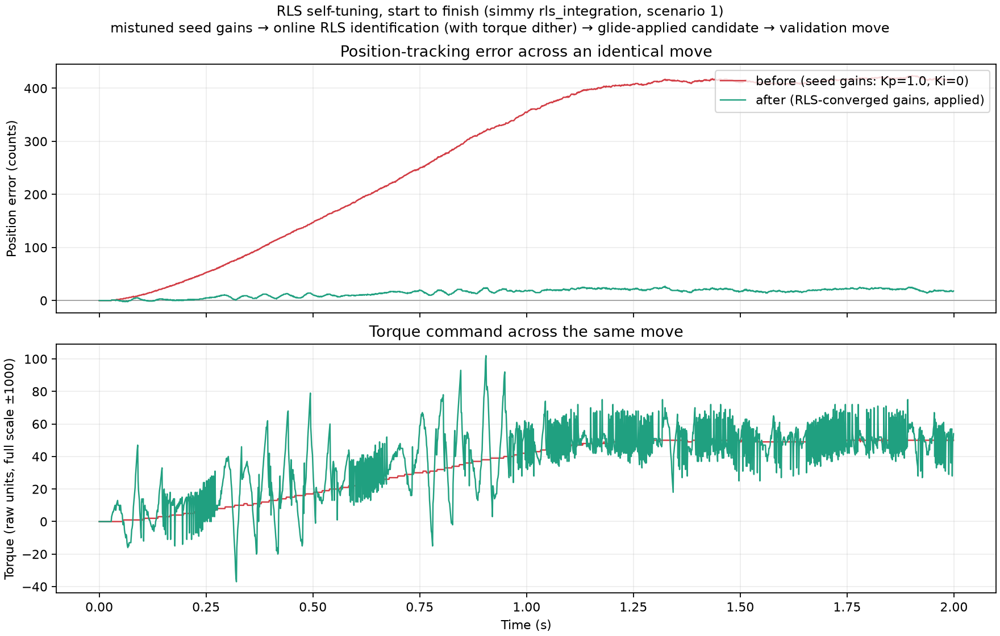

# Examples

## Plain mechanical examples

- **`examples/basic_two_mass.c`** -- a JSON-driven two-body chain
  (`examples/configs/two_mass.json`), demo PD controller, CSV to stdout.
- **`examples/three_mass_leadscrew.c`** -- a three-body chain (motor ->
  belt -> lead screw -> nut [with backlash] -> table,
  `examples/configs/three_mass_leadscrew.json`). Also demonstrates
  reading a body other than the feedback one purely for measurement:
  prints the table's position alongside the motor's, so you can see the
  gap between "what motor-side control achieves" and "what actually
  happens at the load."
- **`examples/bidirectional_move.c`** -- a reversing move through the
  same three-body chain (its own config,
  `examples/configs/bidirectional_move.json`, with a larger nut backlash
  gap so the dead-zone crossing at reversal is clearly visible, not just
  1-2 ticks). Prints the nut's relative displacement and whether it's
  currently inside the backlash dead zone each tick, computed from the
  same public fields the library itself uses -- no special introspection
  API needed.

```sh
make lib test examples
build/basic_two_mass > build/basic_two_mass.csv
build/three_mass_leadscrew > build/three_mass_leadscrew.csv
build/bidirectional_move > build/bidirectional_move.csv
```

## Validating settling accuracy and autotune without hardware

- **`examples/analog_servo_integration/`** -- optional, only builds if a
  `../analog-servo` sibling repo is present. Links the REAL
  `firmware/src/Control.c` from that repo and replays the exact scenario
  its own native test suite already calibrated, confirming the two
  reproduce matching numbers. This is the concrete proof that simmy
  composes with a real external control loop, not just its own demo
  controller.
- **`examples/rls_integration/`** -- optional, only builds if a
  `../analog-servo-rls` sibling worktree is present. Links the REAL
  `firmware/src/{Control,RLS,GainGlide}.c` and runs the same production
  firmware's online, in-move velocity-loop self-tuner (RLS) plus its live
  gain ramp (GainGlide) against three simulated plants, with no physical
  hardware involved:

  1. **Rigid single body** -- the one scenario deliberately built to
     match RLS's own `v[n+1]=a*v[n]+b*u[n]` model as closely as simmy can
     produce. Seeded with deliberately mistuned velocity gains (low Kp,
     no Ki), run through a few moves, then validated before vs. after RLS
     converges and its glide is applied. This is the only scenario the
     example asserts pass/fail on.
  2. **Two-body compliant** (`examples/configs/two_mass.json`, the same
     config the analog-servo integration example's own comment says
     mirrors its calibrated kNema23Leadscrew preset).
  3. **Three-body leadscrew** (`examples/configs/three_mass_leadscrew.json`,
     motor -> belt -> leadscrew -> nut, two compliant stages).

  Scenarios 2 and 3 are a **deliberate model mismatch**: real
  compliance/backlash a single-pole estimator can't represent exactly.
  They're not expected to prove convergence -- they exist to show,
  honestly, what RLS's clamp/`BAD_MEASUREMENT` safety net does against a
  plant it can't represent exactly. Both outcomes are reported, not
  asserted.

  

  Measured in this repo (`make rls-integration`):

  | Scenario | Plant | Before: max accel / cruise error | After: max accel / cruise error | Result |
  |---|---|---:|---:|---|
  | 1 | Rigid, matched | 355 / 424 counts | 24 / 27 counts | `PASS` -- converged, measurably improved |
  | 2 | Two-body compliant (mismatch) | 748 / 1010 counts | 57 / 71 counts | diagnostic, tracking improved |
  | 3 | Three-body leadscrew (mismatch) | 896 / 1019 counts | 74 / 74 counts | diagnostic, tracking improved |

  All three scenarios converge and measurably improve tracking even where
  the plant doesn't match RLS's internal model -- the point isn't that
  the estimator is exact on a mismatched plant, it's that its safety net
  produces a usable result (or honestly flags that it can't) without ever
  touching real hardware. See `examples/rls_integration/main.c` for the
  exact gating/asserted behavior per scenario.

```sh
make rls-integration
```

## Brushed DC

```sh
make examples
build/dc_motor > build/dc_motor.csv
python3 examples/plot_dc_motor.py build/dc_motor.csv docs/plots
```

Only plotting requires Python, NumPy and Matplotlib. See
[the brushed DC motor page](motors/dc.md) for the sample motor and
measured results.

## BLDC

```sh
make test examples test-tools
build/bldc_equivalence > build/bldc_equivalence.csv
build/bldc_circulation > build/bldc_circulation.csv
python3 examples/run_bldc_sweep.py --output build/bldc_faults.csv
python3 examples/run_bldc_sweep.py --steps 8 --output build/bldc_faults_fine.csv
python3 examples/plot_bldc.py build/bldc_faults.csv docs/plots \
    --fine build/bldc_faults_fine.csv \
    --equivalence build/bldc_equivalence.csv \
    --circulation build/bldc_circulation.csv

# Healthy-only baseline plot (speed, torque, winding current):
python3 examples/run_bldc_sweep.py --case wye_healthy --output build/bldc_healthy.csv
python3 examples/plot_bldc_healthy.py build/bldc_healthy.csv docs/plots

# CI-style comparison against a retained historical baseline (no plotting deps):
python3 examples/bldc_metrics.py build/bldc_faults_summary.csv \
    docs/data/bldc_faults_summary.csv --case wye_healthy --case delta_healthy
# Exit 0: pass; 1: heat/task regression; 2: invalid comparison/input.
```

The stdlib-only sweep runner defaults to 256 workers, limited by trial
count; `--jobs` overrides, `--case` selects subsets. Ordered output is
byte-identical to serial execution. See
[the BLDC motor page](motors/bldc.md) for the sample motor and measured
fault/heat results.

## Induction (3-phase)

```sh
make test examples
build/induction_vfd > build/induction_vfd.csv
python3 examples/plot_induction_vfd.py build/induction_vfd.csv docs/plots

build/induction_foc > build/induction_foc.csv
python3 examples/plot_induction_foc.py build/induction_foc.csv docs/plots

build/induction_ifoc > build/induction_ifoc.csv
python3 examples/plot_induction_ifoc.py build/induction_ifoc.csv docs/plots

# Refine only plant integration (steps per command/current interval),
# every control-loop clock stays fixed -- see loop-frequencies.md:
build/induction_vfd --steps 80 > build/induction_vfd_fine.csv
build/induction_foc --steps 8 > build/induction_foc_fine.csv
build/induction_ifoc --steps 8 > build/induction_ifoc_fine.csv
```

See [the induction motor page](motors/induction.md) for the sample motor,
the three drive modes, and measured results.

## PMSM (continuous-angle FOC, no Hall sensors)

```sh
make test examples
build/pmsm_foc > build/pmsm_foc.csv
python3 examples/plot_pmsm_foc.py build/pmsm_foc.csv docs/plots
```

`examples/pmsm_foc.h` / `examples/pmsm_foc.c` are a current+speed PI FOC
controller on simmy's existing sine-wound reduced PM plant
(`SimmyPmParams`/`SimmyPmState`/`SimmyPmStep`) -- the same Park/Clarke +
PI/anti-windup shape as the induction FOC pair above (sharing
`examples/foc_transforms.h`), commutating from a plain sensed electrical
angle rather than true/estimated rotor flux, since a permanent magnet's
flux doesn't need estimating. See [the BLDC/PM motor
page](motors/bldc.md#continuous-angle-foc-no-hall-sensors) for why this
exists and what it deliberately does not add.

## PMSM angle-lock (plant validation)

```sh
make test examples
build/pmsm_angle_lock > build/pmsm_angle_lock.csv
python3 examples/plot_pmsm_angle_lock.py build/pmsm_angle_lock.csv docs/plots
```

`examples/pmsm_angle_lock.h` / `examples/pmsm_angle_lock.c` have no
controller and no feedback at all: a FIXED stator voltage vector pulls
the PM rotor into alignment like a magnetic pendulum, swept across rotor
inertia spanning two orders of magnitude. The point is to validate
`SimmyPmStep` itself -- same restoring torque and electrical damping
every run, only `J` differs, so the measured settling should show the
textbook period ~ `sqrt(J)` scaling and a common equilibrium. See [the
BLDC/PM motor
page](motors/bldc.md#validating-the-plant-forced-alignment-under-a-fixed-voltage-vector)
for the derivation and measured results.

## Stepper

```sh
make test examples
build/stepper_velocity > build/stepper_velocity.csv
python3 examples/plot_stepper.py build/stepper_velocity.csv build/stepper

# Speed sweep and resonance (121 points, .01-1.2 rad/s):
python3 examples/run_stepper_sweep.py velocity --output build/stepper_sweep.csv
python3 examples/plot_stepper_sweep.py

# Compensation experiment (feedforward detent cancellation + active damping):
python3 examples/run_stepper_sweep.py compensation --output build/stepper_compensation_sweep.csv
python3 examples/plot_stepper_compensation.py build docs/plots

# Abrupt-start / energized-stop slip regressions:
build/test_stepper_moves --csv build/stepper_moves.csv
python3 examples/plot_stepper_moves.py build/stepper_moves.csv docs/plots/stepper_start_stop_slip
```

Only plotting requires Python, NumPy and Matplotlib. See
[the stepper motor page](motors/stepper.md) for the sample motor and
measured results.

## Solenoid / linear actuators

```sh
make test examples
build/solenoid_actuators > build/solenoid_actuators.csv
python3 examples/plot_solenoid_actuators.py build/solenoid_actuators.csv docs/plots

# Closed-loop PID lift/descend against gravity (voice coil only -- see
# examples/voicecoil_pid_experiment.h):
build/voicecoil_pid > build/voicecoil_pid.csv
python3 examples/plot_voicecoil_pid.py build/voicecoil_pid.csv docs/plots
```

Only plotting requires Python, NumPy and Matplotlib. `solenoid_actuators`
runs both sample motors open-loop -- an iron-core reluctance solenoid
pulling in under constant voltage, and a voice coil pushed and pulled by
a sine drive. `voicecoil_pid` closes the loop with a genuine PID on a
vertical voice-coil actuator fighting gravity, with no mechanical return
spring. See [the solenoid/linear actuator page](motors/solenoid.md) for
the sample motors and measured results.

## Single-axis identification prototype

See [axis identification](axis_identification.md) for a minimal sensor
setup, excitation/validation moves, and the boundaries of a useful model,
and [the device protocol](axis_device_protocol.md) for the wire contract
the `characterization_rig` firmware implements.
`examples/identify_axis.py` generates offline motion plans, delegates
acquisition to an explicit hardware adapter, and fits a rigid baseline or
a two-body compliance/backlash model from measured effort and position.
NumPy is required, with optional SciPy for two-body fitting and
Matplotlib for plots. These tools add no C-library dependencies and are
not realtime controllers.
