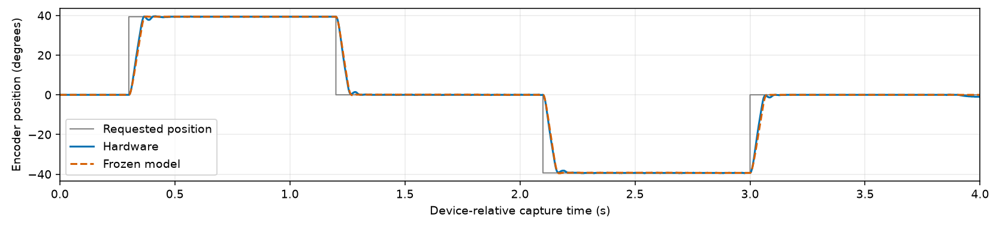

# simmy

## Same PC tuner, simulated and real motor

**Develop and test your control software against a model that behaves like your
machine.** One unchanged PC tuner independently tunes the same production
controller against a frozen SM232AE/TQ10 model and the real motor. The resulting
position responses closely track each other—useful feedback before you get to
the bench, using the same code you'll run there.

[Worked example, fitting context and reproduction commands](axis_controller_development.md).

## Library overview

A small mechatronics simulation library: a serial chain of rigid bodies
connected by compliant (spring + damper + backlash) couplings, a
composable "analog signal chain" standing in for a real DAC/amplifier
signal path, and a bidirectional pulse source for step/dir-style
position commands -- plus brushed DC, permanent-magnet/BLDC, voltage-driven
induction, current-driven stepper, and linear electromagnetic actuator
(reluctance solenoid + voice coil) motor models. No opinion on control
algorithms: you drive it with a plain function pointer, which may be a
three-line demo P loop or a real production control cascade linked in
from somewhere else.

Describe your mechanism in JSON, plug in your controller, and run repeatable
experiments on your laptop or in CI. Start with an example configuration, then
[fit a model to your recordings](characterization_fitter.md) as you bring it closer
to your own machine.

## Why simmy

- **Fast enough to iterate on.** Measured on 2012-era Sandy Bridge
  hardware[^1]: ~200x realtime for basic multi-body mechanical physics
  (`build/three_mass_leadscrew`), ~1.6x realtime for a full electrical
  motor simulation (`build/bldc_faults --case wye_healthy`). No GPU, no
  cluster, and no bench to book: fixed-step runs reproduce exactly, so
  your real test suite can run against the simulated plant on every
  commit instead of waiting for hardware time.
- **Validates settling accuracy and autotune behavior without physical
  hardware.** The real production RLS self-tuner and gain-glide firmware
  can run, converge and be scored against simulated plants it was never
  shown before -- including plants that deliberately mismatch its
  internal model. See [examples](examples.md#validating-settling-accuracy-and-autotune-without-hardware).
- **No opinion on control algorithms.** A three-line demo P loop and a
  real production control cascade are both ordinary implementations of
  the same function-pointer typedef -- see
  [driving simmy with your own controller](integration.md).
- **Five motor families, one mechanical/analog core.** A single-winding
  [brushed DC](motors/dc.md) motor (no commutation, no drive clock, just
  Kirchhoff's voltage law); [BLDC/permanent-magnet](motors/bldc.md)
  models with explicit faults and heat accounting; a voltage-driven
  [3-phase induction machine](motors/induction.md), drivable by open-loop
  V/Hz or either of two FOC controllers (an ideal flux benchmark and an
  encoder-assisted indirect estimator); a current-driven two-phase
  [stepper](motors/stepper.md); and [linear electromagnetic
  actuators](motors/solenoid.md) -- an attraction-only reluctance solenoid
  and a bidirectional voice coil -- roughly simplest to most complex.
- **C compiler + libm only.** No Python, no third-party JSON library for
  the core library and tests; plotting examples are optional.

## Where to go next

| If you want to... | See |
|---|---|
| Build it and run a minimal example | [Build](build.md) |
| Run a fitted plant and compare it with the bench | [Bundled models and comparison plots](bundled-models.md) |
| Pick sample parameters for a motor | [Brushed DC](motors/dc.md), [BLDC](motors/bldc.md), [Induction (3-phase)](motors/induction.md), [Stepper](motors/stepper.md), [Solenoid/linear actuators](motors/solenoid.md) |
| Understand the fixed clock rates in the examples | [Loop frequencies](loop-frequencies.md) |
| Wire in your own controller | [Driving simmy with your own controller](integration.md) |
| Know what's deliberately out of scope | [Scope and non-goals](scope.md) |
| See every example and its reproduction commands | [Examples](examples.md) |
| Fit a chain topology to recorded data, quick and zero-interaction | [characterization_fitter](characterization_fitter.md) |

## License

MIT, see `LICENSE` in the repository root.

[^1]: Intel(R) Xeon(R) CPU E5-1650 0 @ 3.20GHz.
