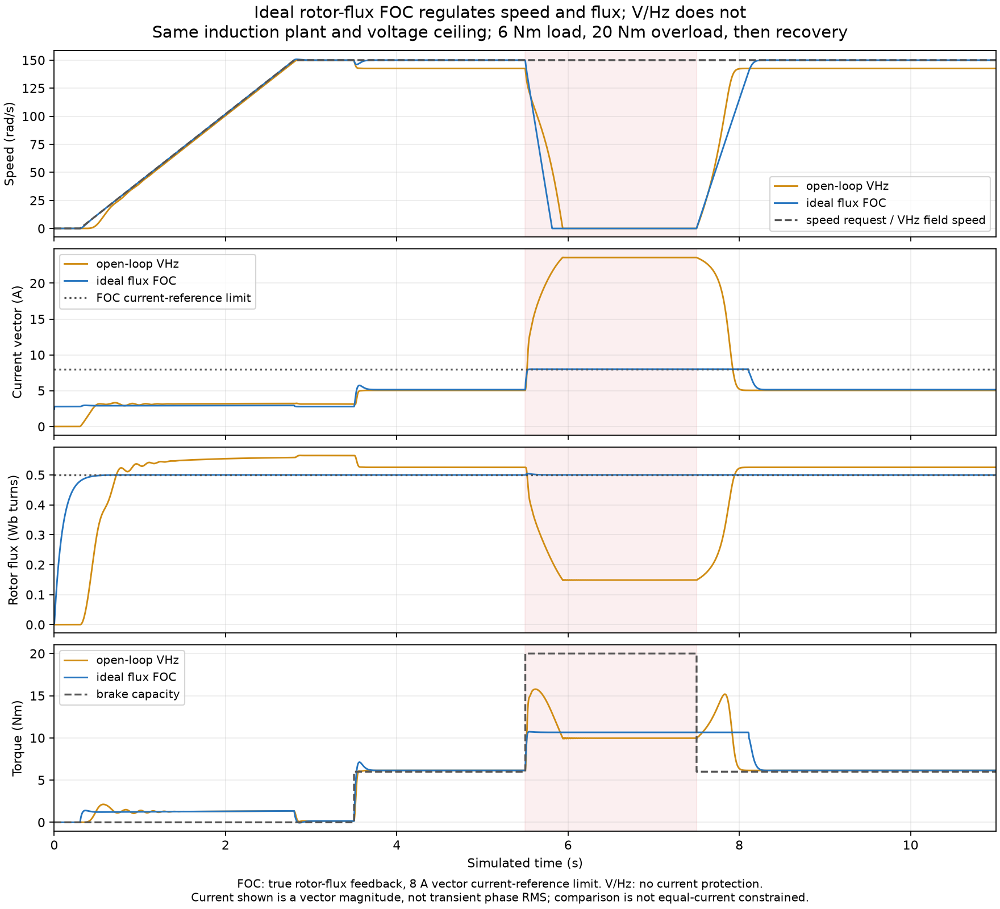

# Ideal rotor-flux-oriented control on the averaged induction plant

## What this milestone establishes

The induction machine from [the V/Hz milestone](induction-vfd-notes.md) is
unchanged. A separate example controller now generates alpha/beta voltage
from speed, actual stator currents, and **true simulated rotor flux**.
This is an ideal-information benchmark, **not sensorless FOC**, not a flux
observer, and not production firmware. Control policy lives under
`examples/`, preserving the library's separation of plant and controller.

The example demonstrates flux establishment, cascaded speed/current
control, load rejection, reference/voltage saturation, anti-windup and
recovery. It does not promise hard actual-current protection, eliminate
physical voltage limits, or validate control on a real motor.

## Architecture and clocks

```
speed request (1 kHz) -> speed PI -> q-current reference
flux request -> d-current reference
        true rotor-flux angle + actual stator current
                          |
                          v
        Park -> current PI + decoupling (10 kHz)
             -> voltage circle + anti-windup
             -> inverse Park -> held alpha/beta voltage
                          |
                          v
        unchanged induction machine + mechanical chain (40 kHz)
```

The V/Hz comparison uses the same mechanical/electrical parameters and
voltage ceiling, with the same 1 kHz command and 10 kHz held-voltage
interface. This differs slightly from the first standalone V/Hz example,
which evaluates its sinusoidal oscillator at each plant step. The
comparison deliberately holds **both** drives' voltages between 10 kHz
ticks. No plant state is overwritten to match current, flux, speed or
position references.

`--steps 4` means four 25 us plant steps per 100 us current tick. With
`--steps 8`, plant steps are 12.5 us while all loop clocks, PI gains,
reference updates and brake changes stay fixed. The plant remains a
partitioned electrical-RK4/mechanical solver, not a fully coupled RK4
controller/plant solver. Execution is offline fixed-step, not real-time.

## Coordinates, current/flux control, and limits

Amplitude-invariant Park transform and inverse:

```
id =  ia*cos(angle) + ib*sin(angle)
iq = -ia*sin(angle) + ib*cos(angle)

angle = atan2(true_rotor_flux_beta, true_rotor_flux_alpha)
```

The angle is **rotor-flux angle, not shaft mechanical angle**. For this
orientation:

```
torque = (3/2)*p*(Lm/Lr)*|psi_r|*iq
id_reference = flux_reference/Lm
```

The d-axis reference establishes .5 Wb turns rotor flux. At startup,
q-current demand is held at zero until true flux reaches 90% of that
request; the readiness flag clears below 50%. Zero flux has no defined
angle, so the initial orientation is chosen as zero while the flux
builds. The tests include a nonzero speed request pending from t=0 to
verify that the gate, not just the example's reference delay, prevents
premature torque-current demand.

Once ready, a speed PI outputs torque demand. The instantaneous
flux-based torque coefficient converts that to q-current demand.
The vector-current reference is limited to 8 A, preserving the d-axis
flux-current allocation and using the remaining circle for q current:

```
iq_limit = sqrt(Imax^2 - id_reference^2)
```

Actual currents are plant outputs and are **never clipped** to those
references. This is a software demand limit, not an instantaneous physical
current ceiling or a simulated trip circuit.

Current PI outputs are augmented by flux-derivative and rotational
cross-coupling feedforward. For `Lsigma=Ls-Lm^2/Lr` and `tau_r=Lr/Rr`:

```
omega_flux = p*omega + (Lm/tau_r)*iq/|psi_r|
vd_ff = (Lm/Lr)*(Lm*id-|psi_r|)/tau_r - omega_flux*Lsigma*iq
vq_ff = omega_flux*(Lsigma*id + (Lm/Lr)*|psi_r|)
```

The slip division is disabled near zero flux. Stator resistance is
handled by the PI integral terms, not duplicated in feedforward. The
voltage vector is projected onto a 187.794 V circle; current integrators
use back-calculation from applied versus raw voltage. The speed
integrator tracks the torque allowed by its current-reference limit and
conditionally inhibits error integration when voltage is saturated and
additional effort would push further into that saturation. It does not
accumulate unlimited demand during the stalled/voltage-limited holds.

Default tuning assumes the illustrative .02 kg m^2 inertia. Current
bandwidth is 300 Hz (`Kp=Lsigma*2*pi*300`, `Ki=Rs*2*pi*300`); speed-loop
tuning uses a nominal 5 Hz, damping .9 second-order response. These are
example choices, not automatically tuned robust gains. FOC requires
positive rotor resistance, a positive flux request and voltage limit,
and a vector-current limit above the magnetizing-current allocation.

## Speed and load comparison



Both start at rest and zero flux. The speed request remains zero through
.3 s, then ramps at 60 rad/s^2 to 150 rad/s. For V/Hz this request maps to
**field speed**, via `frequency=p*speed_request/(2*pi)`, not a closed-loop
rotor-speed command. FOC pre-establishes flux during the initial delay;
V/Hz applies zero terminal voltage at zero frequency.

A 6 Nm passive brake is applied at 3.5 s, increased to 20 Nm at 5.5 s,
then reduced to 6 Nm at 7.5 s. As before, a stationary brake's specified
capacity is not necessarily its actual reaction torque or power.

| Steady interval | V/Hz rotor speed | FOC rotor speed | V/Hz current vector | FOC current vector |
|---|---:|---:|---:|---:|
| Unloaded, 3.3–3.5 s | 149.843 rad/s | 150.000 rad/s | 3.141 A | 2.780 A |
| 6 Nm, 5.3–5.5 s | 142.578 rad/s | 150.000 rad/s | 5.046 A | 5.146 A |
| 20 Nm, 7.3–7.5 s | 0 rad/s | 0 rad/s | 23.581 A | 8.000 A |
| Recovered, 10.8–11 s | 142.578 rad/s | 150.000 rad/s | 5.046 A | 5.146 A |

These currents are instantaneous alpha/beta vector magnitudes, not
transient phase RMS. The comparison has the **same voltage ceiling, but
not the same current protection**: V/Hz still has no current limiter/trip,
whereas FOC limits its current reference. It is not an equal-current
performance or efficiency comparison. FOC also requests a different,
controlled flux level (.5 Wb turns). Do not attribute every difference
solely to a coordinate transform.

FOC stalls earlier under the 20 Nm brake because its available torque is
limited to about 10.66 Nm by the current allocation and flux request.
It maintains ~.5 Wb turns flux at standstill and restarts when brake
capacity falls. An actual drive could trip or overheat; no protection
or temperature model is included.

### The load transient is not an instantaneous speed correction


Applying 6 Nm briefly drops FOC speed to **146.135 rad/s**, then speed PI
restores 150 rad/s. The q-current demand rises while d current remains
near the magnetizing allocation. V/Hz instead settles at a load-dependent
speed. The FOC steady voltage rises from ~158.94 V unloaded to ~180.80 V
loaded, below the common 187.794 V ceiling.

This is finite-bandwidth dynamics, not a plant-side velocity assignment.
The figure also shows actual versus requested dq currents; the traces
nearly coincide at this plotting scale, rather than implying currents
are prescribed directly.

## Voltage ceiling and anti-windup stress


A separate no-brake FOC run requests a 200 rad/s^2 ramp to **350 rad/s**,
which is unattainable at the requested flux and available voltage. Actual
speed settles near **185.8 rad/s**, voltage stays at its ceiling, and
actual flux falls below its request because the current loops cannot
maintain their demand. No field-weakening controller is implemented.

At 3.5 s the reference drops abruptly to 100 rad/s. The controller leaves
saturation, decelerates and settles at 100 rad/s. Integrator state returns
to normal operating levels instead of remaining wound up. Roughly 39.69%
of the 10 kHz current intervals were voltage-saturated during this run.

**The abrupt release exposes a real limitation of this benchmark:**
actual current peaks around **11.93 A** despite an 8 A current-reference
limit. The trace sampled at 1 kHz records ~11.92 A; finer plant-step peak
tracking records ~11.933 A. Available voltage and finite current-loop
bandwidth prevent instantaneous current tracking. The example deliberately
retains this overshoot; it does not clamp electrical state or silently
add a protection mechanism. Hardware overcurrent limiting/tripping,
reference slew control, regeneration/DC-bus limits and field weakening
are separate future work. Even the main comparison has a small ~8.0008 A
peak around the nominal 8 A request ceiling.

Thus “current-limited FOC” must be phrased carefully here: **current-demand
limited**, not a guaranteed physical current bound. Anti-windup makes
recovery possible; it cannot create voltage headroom or guarantee safety.

## Validation and numerical sensitivity

`tests/test_induction_foc.c` covers:

- Park/inverse-Park round trips and vector magnitude preservation.
- Torque sign/scaling against independently constructed induction states.
- Flux readiness/hysteresis, pending speed demand from zero flux, and
  zero torque-current request before readiness.
- Current-reference circle and voltage-vector limits.
- Explicit current-integrator back-calculation and outer integrator
  inhibition under voltage saturation (not merely clipping outputs).
- Load rejection, finite speed dip, current-limited stall and recovery.
- Long voltage saturation followed by recovery, bounded/cleared
  integrators, and documented actual-current overshoot.
- Forward/reverse symmetry under a passive brake.
- Fixed speed/current clock counts while refining only the plant grid.

Over all three generated traces, halving plant dt from 25 to 12.5 us
changed sampled speed by at most .00233 rad/s, torque .00177 Nm, current
vector magnitude .00122 A, flux .000020 Wb turns and voltage magnitude
.00511 V. Both controller clocks and the held-voltage interface stayed
fixed. This is numerical sensitivity for these cases, not a universal
error bound. The original induction equivalent-circuit/energy checks and
all stepper/mechanical tests remain in the suite.

## Files and reproduction

- `examples/induction_foc.h`: pure example controller and Park transforms.
- `examples/induction_foc_experiment.h`: shared comparison fixture/schedule.
- `examples/induction_foc.c`: normal comparison and voltage-ceiling stress CSV.
- `tests/test_induction_foc.c`: C-only tests using the same controller/fixture.
- `examples/plot_induction_foc.py`: optional plots and steady-window summary.

```sh
make test examples
build/induction_foc > build/induction_foc.csv
python3 examples/plot_induction_foc.py build/induction_foc.csv docs/plots
# Refine plant resolution only; speed stays 1 kHz and current stays 10 kHz:
build/induction_foc --steps 8 > build/induction_foc_fine.csv
```

PNG/SVG figures in `docs/plots/` and compact summary data in
`docs/data/induction_foc_summary.csv` survive `make clean`. Full raw CSV
is a generated artifact under `build/`. Plotting requires NumPy and
Matplotlib; numerical examples/tests remain C + libm only.

## Indirect successor and future firmware observer

An **[encoder-based indirect FOC variant](induction-ifoc-notes.md)** now
removes privileged flux feedback using a scalar flux model and slip-angle
integration. A separate firmware rotor-flux observer remains future work.
Preserve this true-flux benchmark as an oracle for validation, but do not give the estimated-flux controller access to true
rotor-flux angle, magnitude or derivative. Current control should receive
only its permitted current, voltage and speed measurements/estimates.

Test rotor-resistance/time-constant mismatch, initialization, flux-angle
error, encoder sampling and estimation delay. Sensorless control can
follow; accurate low/zero-speed flux estimation is a distinct challenge.
The present exact-parameter decoupling and ideal feedback are intentionally
optimistic. Linear magnetics, omitted inverter/thermal effects and lack
of hardware protection remain plant/drive limitations, not evidence of
successful real-world FOC.

For a future article, pair the load-rejection plot (what closed-loop
control achieves) with the voltage-limit plot (what it cannot achieve).
Avoid showing only steady speed regulation or labeling true-flux control
as sensorless. The current overshoot makes a useful concrete distinction
between a software request limit and a physical actuator constraint.
