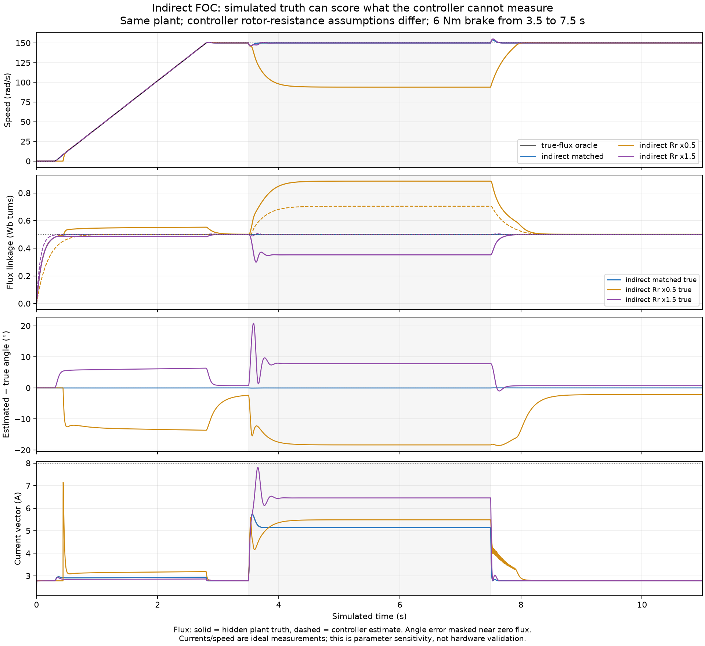
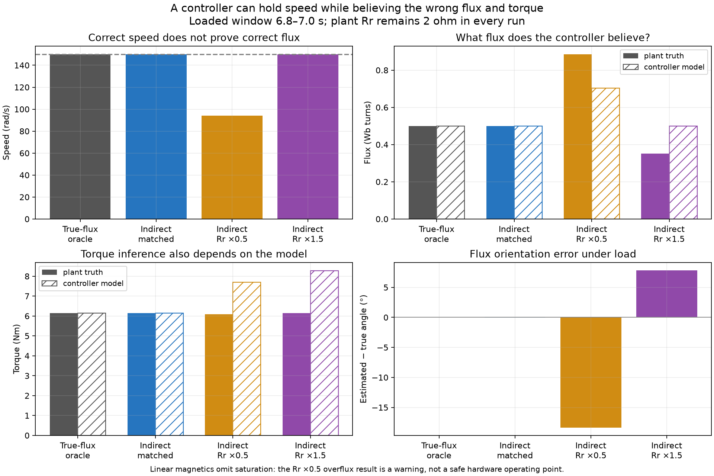

# Indirect FOC: estimate flux here, evaluate against hidden simulated truth

## Why the simulator helps

We choose a motor model and parameters, then integrate its electrical
states. Its rotor-flux linkage is **reference truth within that model**,
not a commanded value and not a measurement from a real motor. It is a
lumped effective flux-linkage vector, not a resolved spatial magnetic
field. The controller's .5 Wb request need not be the motor's actual flux.

This lets us hide flux from the controller while retaining it for
scoring. It validates an estimator against a specified model, not that
model against hardware. Matching model parameters are an implementation
check; deliberately mismatched parameters are the more informative test.

## What is implemented

Encoder-assisted indirect rotor-flux-oriented control now runs on the
unchanged induction plant and shared current/speed PI core. It constructs
flux orientation from shaft speed plus model-based slip rather than
reading the plant's rotor-flux vector. No new firmware observer is built.
The true-flux controller remains as a separate oracle benchmark.

The indirect controller's measurement structure contains only:

```
IfocMeasurements:
    statorCurrent[alpha, beta]     A
    shaftSpeed                    mechanical rad/s
```

There is **no plant pointer or true-flux field**. All flux-dependent paths
use the estimate: startup gating, torque-to-current conversion,
Park/inverse Park, and current-loop decoupling. Nominal electrical
parameters are constructed separately; changing the plant does not
silently update the controller's assumptions.

Currents and speed are still ideal simulated measurements. Encoder
quantization, velocity estimation, ADC offsets/noise and latency remain
future measurement-model work. We have not identified parameters from
hardware or demonstrated real-world flux accuracy.

## Indirect estimate and scheduling

With currents transformed into the estimated flux frame:

```
d(psi_hat)/dt = (Lm_hat*id_measured - psi_hat)/tau_r_hat
omega_slip_hat = (Lm_hat/tau_r_hat)*iq_measured/psi_hat
d(angle_hat)/dt = polePairs_hat*shaftSpeed + omega_slip_hat
```

The scalar magnitude model uses an exact exponential step for held
measured d current. Slip uses midpoint predicted magnitude, with division
disabled below 10% of requested flux; estimated magnitude is nonnegative.
Angle wraps numerically, but it is not reset from the true flux angle.
The current tick first uses the same-timestamp estimate for voltage
control, then predicts to the next tick. Plant integration advances to
that same timestamp independently. Neither estimator nor controller is
advanced at the finer plant integration rate.

The model uses **measured currents, not current references**: requesting
magnetizing current must not create an estimated flux if measured current
is zero. This also matters when voltage saturation prevents reference
tracking. Gating retains the shared 90% ready / 50% dropout thresholds,
now based on estimated magnitude only.

“Indirect” is not an absence of estimation. This scalar current-model and
slip calculator is a state estimator; a current-model flux-vector observer
can be mathematically closely related. An observer using the same model
and parameters is not necessarily an independent cross-check.

The speed loop remains 1 kHz, current/estimate updates 10 kHz, plant grid
40 kHz by default. Reference-current limit, voltage ceiling and PI gains
are unchanged from the ideal FOC benchmark.

## Parameter-mismatch experiment



The physical plant always has referred rotor resistance 2 ohm. Controller
assumptions are 2 ohm (matched), 1 ohm (x0.5) and 3 ohm (x1.5). Only the
controller's rotor time constant changes; its assumed stator resistance,
inductances, PI gains and limits are otherwise identical. These are
controlled parameter perturbations, not a temperature simulation.

All runs start from rest and zero flux, ramp to 150 rad/s, apply a 6 Nm
passive brake from 3.5 to 7.5 seconds, then remove it. This intentionally
isolates load application/removal rather than repeating the earlier FOC
benchmark's 20 Nm overload/stall-recapture profile. Runs share the same
parameters/excitation schedule, but their closed-loop trajectories can
differ; they are not replaying an identical current-measurement stream.

Solid flux curves are hidden plant truth; dashed curves are controller
estimates. Angle error is wrapped estimate-minus-truth and is masked
unless both flux magnitudes exceed .05 Wb turns. That scoring mask never
feeds back into control.

Loaded window 6.8–7.0 s:

| Controller | Speed rad/s | True flux | Estimated flux | Flux-angle error | Actual / inferred torque |
|---|---:|---:|---:|---:|---:|
| True-flux oracle | 150.00 | .4996 | .4996 (privileged) | 0 degrees | 6.150 / 6.150 Nm |
| Indirect, matched | 150.00 | .4999 | .5000 | -.021 degrees | 6.150 / 6.154 Nm |
| Indirect, Rr x0.5 | 93.94 | .8854 | .7034 | -18.35 degrees | 6.094 / 7.692 Nm |
| Indirect, Rr x1.5 | 150.00 | .3519 | .5000 | +7.84 degrees | 6.150 / 8.278 Nm |

Flux units are Wb turns. Inferred torque is calculated from estimated
flux/frame and measured current, not from the speed loop's torque
request. The oracle's estimate equals truth by construction and is not
being presented as a physical estimator.



The high-Rr controller still tracks speed, but substantially overestimates
flux and torque. **Speed regulation alone does not validate flux
estimation.** The low-Rr controller becomes overfluxed and voltage-limited;
its speed drops severely under load. The unsaturated plant permits .8854
Wb turns without modeling the additional saturation/heating of a real
motor, so that state is a warning about this controller/model pairing,
not a safe or quantitatively validated hardware operating point.

The main qualitative conclusion survives plant timestep refinement.
Matched-controller 25 versus 12.5 us maximum speed differences are about
.00012 rad/s, with the loop clocks fixed. The severe x0.5 voltage-limited
transient is more sensitive: maximum speed difference about .038 rad/s;
the next refinement gives about .053 rad/s rather than decreasing
monotonically. Do not claim precision convergence of that transient.
Its steady loaded speed/flux and the large mismatch conclusions remain
essentially unchanged. Saturation/conditional-integration transitions
need more care before using such traces for threshold prediction.

## Validation

`tests/test_induction_ifoc.c` verifies:

- Analytical scalar-flux response and slip-angle advancement.
- No flux inferred from a current request when measured current is zero.
- True pre-existing plant flux does not release indirect startup gating
  when the controller estimate is zero.
- Plant parameter changes do not overwrite nominal controller parameters.
- Matched closed-loop agreement with the oracle and small flux-angle error.
- Mismatch produces substantial flux errors even with correct speed, and
  severe low-Rr mismatch can impair speed tracking.
- Current-reference/voltage limits, reverse-direction symmetry, and fixed
  estimator/controller clocks during plant-only refinement.

The ideal true-flux FOC, induction circuit/energy and older mechanical/
stepper regressions still run. Estimator and control code remain examples,
not a new production-control API.

## Later: use a firmware observer to evaluate this, and vice versa

If real control firmware later uses FOC with a flux observer, the useful
comparison is a three-way one:

1. Indirect estimate from its permitted measurement stream and nominal model.
2. Firmware observer estimate from its own permitted currents/voltages/speed.
3. Hidden plant truth used only by the evaluation/plotting layer.

Run one estimator in shadow alongside the other controller, or replay the
**same timestamped measurement and applied-voltage stream** into both.
This distinguishes estimator disagreement from differences caused by
closing different controllers around different trajectories. The current
1 kHz diagnostic CSVs are not a full 10 kHz observer replay contract;
we would need to log/replay actual alpha/beta currents, reconstructed or
applied voltages, speed and timing at the proper acquisition rate.
`IfocEstimateStep` is separate from voltage control so it can run in shadow.

On real hardware there is no convenient true rotor-flux trace. Agreement
between indirect FOC and an observer is useful, but not proof: shared
rotor-time-constant errors or current offsets can make both agree while
wrong. A voltage-based/adaptive observer may offer different error modes
from this current-model slip calculation, but it still requires validation.
Measured torque/load response, current prediction residuals and independent
parameter-identification experiments remain important.

## Files and reproduction

```sh
make test examples
build/induction_ifoc > build/induction_ifoc.csv
python3 examples/plot_induction_ifoc.py build/induction_ifoc.csv docs/plots
# Same controller/estimate rates, finer plant grid:
build/induction_ifoc --steps 8 > build/induction_ifoc_fine.csv
```

- `examples/induction_ifoc.h`: measurement-only indirect estimator/control boundary.
- `examples/induction_foc.h`: shared current-control core plus privileged oracle wrapper.
- `examples/induction_foc_experiment.h`: separate nominal-model construction and scheduler.
- `examples/induction_ifoc.c`: scoring-only access to hidden flux and parameter comparison.
- `examples/plot_induction_ifoc.py`: retained PNG/SVG figures and compact summary CSV.
- `docs/data/induction_ifoc_summary.csv`: retained summary, not a raw observer-replay dataset.

The numerical suite needs only C and libm. Plotting optionally uses Python,
NumPy and Matplotlib. No new observer or hardware measurement system is
implemented in this milestone.
