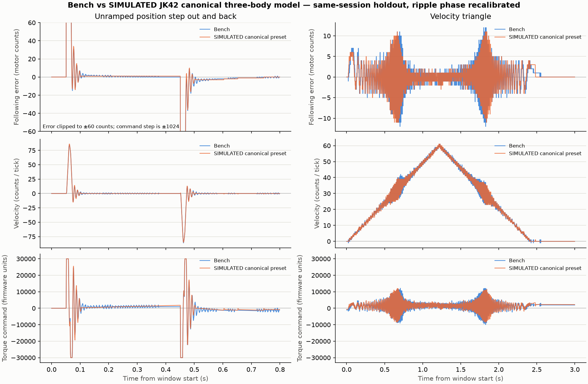
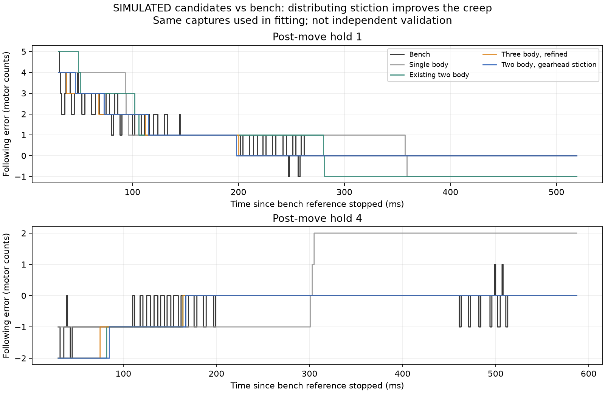

# Preset: JK42 / OEM770T, two-stage gearhead

Run the analog-servo controller against a fitted JK42 motor, OEM770T drive,
and two-stage planetary gearhead with nothing attached to the output.
The canonical preset is `models/jk42_oem770t_gearhead_noload.json`.

!!! warning "Fitted to one bench session, not independently validated"
    The three bodies are effective states, not measured stage mechanics.
    Stage ratios, stiffnesses, inertias, and friction shares remain
    uncertain. Same-session holdout checks do not establish performance
    with another load or controller tune.

## Stepping and units

Load both the mechanical and analog chains from the preset. Run the
analog chain **ten times per 1 ms tick**, stepping the mechanical chain
by `0.1` tick after every call. The preset's four internal mechanical
substeps give 40 mechanical steps per control tick.

```c
SimmyChainParams chain;
SimmyAnalogChainParams drive;
/* Check both return values before using the parameters. */
SimmyChainParamsFromJsonFile("models/jk42_oem770t_gearhead_noload.json", &chain, err, sizeof err);
SimmyAnalogChainParamsFromJsonFile("models/jk42_oem770t_gearhead_noload.json", &drive, err, sizeof err);
SimmyChainState state;
SimmyAnalogChainState amp;
SimmyChainInit(&state, &chain);
SimmyAnalogChainInit(&amp, 1);

for (;;) { /* one 1 ms controller tick */
    int32_t position = SimmyChainFeedbackPositionCounts(&state, &chain);
    double torque = MyControllerTick(position);
    for (int i = 0; i < 10; ++i) {
        double shaft = SimmyAnalogChainStep(&amp, &drive, torque);
        SimmyChainStepDt(&state, &chain, shaft, 0.1);
    }
}
```

- Body 0 is the motor encoder: 4000 decoded counts per motor revolution.
- All other bodies use **motor-reflected** counts. The measured ratio is
  about 54989 motor counts per output revolution. Divide body 2's position
  by 54989 to obtain output revolutions.
- Physical downstream inertia is divided by the cumulative reduction
  ratio squared when reflected to the motor. The preset already contains
  reflected coefficients; do not transform them again.
- Torque is the firmware's signed command scale, full scale ±32767. It is
  not measured current or N·m. Inertia is command units per count/tick².
- Each backlash value is a **half-gap** in motor-reflected counts.
- Ripple phase is relative to the fitting capture's encoder zero. For
  another zero, adjust phase rather than treating it as a new gearbox.

## Three effective bodies

```
motor + first sun
    -- spring / damper / backlash --
first carrier + second sun
    -- spring / damper / backlash --
second carrier + output
```

| Parameter | Motor | Intermediate | Output |
|---|---:|---:|---:|
| Inertia | 2437.7815 | 203.3029 | 150.0188 |
| Viscous friction | 4.5604 | 1.6697 | 1.2321 |
| Coulomb friction | 759.1430 | 277.9376 | 205.0924 |
| Stiction | 1151.1525 | 538.6149 | 397.4483 |

| Link | Stiffness | Damping | Backlash half-gap |
|---|---:|---:|---:|
| Motor to intermediate | 27204.5540 | 1626.4228 | 17.0229 |
| Intermediate to output | 1667.2744 | 122.4961 | 17.1698 |

The motor has position-locked ripple of amplitude 1255.51 command units,
period 333.25 motor counts, and phase 0.696183 radians. Its constant bias
is −26.05, and torque-proportional Coulomb coefficient is 0.003674.
The analog chain adds a delay of 0.20963 tick and lag of about 0.08106 tick.
There is no fitted noise or slew stage.

## Bench comparison



The model was fitted jointly to `simset` closed-loop moves and a velocity
triangle, `sq` open-loop torque squares, `ripdir` jogs, and `backlash`
slow reversals, captured on 2026-11-26. The real analog-servo `Control.c`,
`Signal.c`, `MotionQueue.c`, and `MotionReference.c` ran each candidate,
using the `planner-lead-10ms` configuration and fast-planner flags.

The comparison above uses the same-session `readme_jk` holdout, with older
controller settings. Only ripple phase was recalibrated by a 25-point
scan against its ramp envelope; the step/creep response was not refitted.

| Holdout metric | Bench | Simulated |
|---|---:|---:|
| Step out overshoot, counts | 15 | 14 |
| Step back overshoot, counts | 9 | 10 |
| Step out settle within ±5, ms | 49 | 47 |
| Step back settle within ±5, ms | 59 | 48 |
| Ramp maximum following error, counts | 12 | 11 |
| Ramp torque-envelope peak | 7468 | 6930 |

### Creep and sensitivity checks



Training-window late-hold mismatch is 0.525 counts RMS, compared with
1.151 for the single-body fit. Moving the canonical model's friction
back onto the motor raises mismatch to 1.105 without removing the other
bodies. A two-body model with gearhead stiction also reaches about 0.53:
**distributed stiction matters more than the extra inertia for creep.**

Doubling mechanical substeps changes mismatch from 0.525 to 0.530, and
original whole-workload score from 12.73 to 12.74. Perturbing all inertias
by ±0.001% and ±0.01% keeps mismatch at 0.520–0.529 and score at 12.73–13.39.
These are limited numerical checks, not parameter-confidence bounds.

## Limits and reproduction

- The simulation still slips in discrete steps rather than reproducing
  every fine creep/dither event.
- The holdout comes from the same bench session, with a recalibrated
  spatial phase. It is not an independent validation recording.
- Motor-side feedback without an applied load does not identify each
  planetary stage's inertia, friction, compliance, or output backlash.
- The aggregate fit is useful for controller experiments, but should not
  silently determine live gains or stand in for loaded qualification.

The analog-servo experiment bundle at
`experiments/motion-planner/gearhead-multibody/` contains the source/data
snapshot, search scripts, scores, ablations, and replay traces. Its
`refined-three-body.json` records this fit. Loading the canonical JSON
instead of passing its coefficients directly produces **14,093 identical
frames** in position, velocity, torque, reference position, and velocity
integral for the fitting move sequence.

`make test` checks preset loading, the stepping contract, distributed
stiction, quiet rest, bidirectional torque pulses, and a bounded example
PD move. These are regression tests, not new bench evidence.

To redraw the comparison from aligned bench and simulated frame lists
(the replay must already use the capture's controller settings and phase):

```sh
python examples/plot_preset_comparison.py \
  --bench readme_jk.json --sim readme-jk42-refined.json \
  --step 1550 2350 --ramp 6200 9200 \
  --title 'Bench vs SIMULATED JK42: same-session holdout, phase recalibrated' \
  --out docs/assets/models/jk42-readme-comparison.png
```

This optional plotting tool needs NumPy and Matplotlib; the C library and
preset tests do not.

[All bundled models and comparison plots](bundled-models.md).
