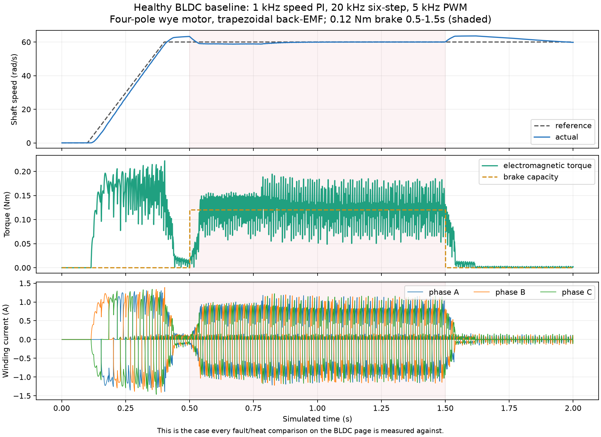
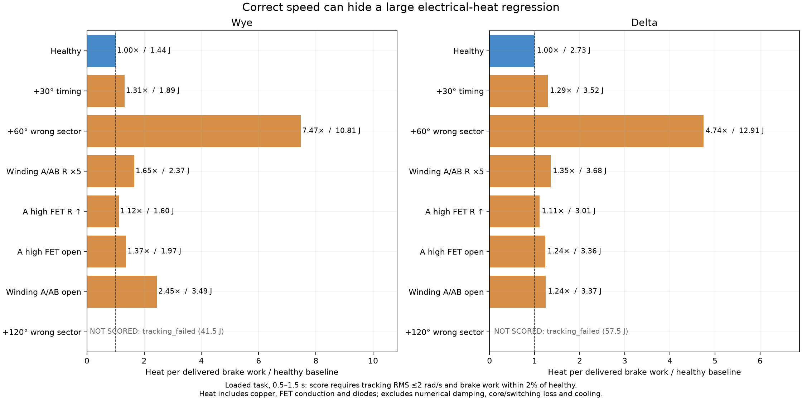
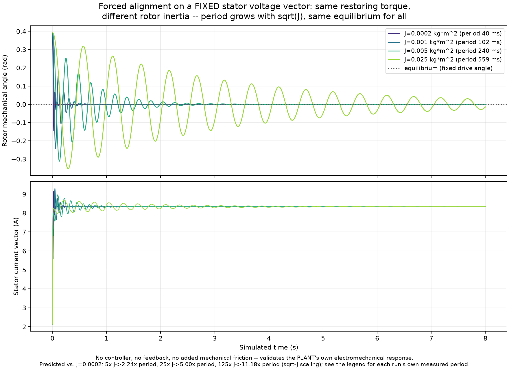

# BLDC / permanent-magnet motor

Give this model a bus voltage and gate states and it solves winding
currents, torque, and heat from the actual circuit -- at two levels of
detail, both sharing the existing mechanical chain and SI torque/speed
interfaces. Public declarations are in `include/simmy_bldc.h` (also
included by `include/simmy.h`); parameters load from the C API or from
JSON (see [the motor sections of the config schema](../build.md#motor-sections)).

It's an equation-level circuit model: solving the circuit exactly still
leaves out what the circuit doesn't represent, chiefly mutual inductance
and magnetic saturation, so treat its numbers as internally consistent
rather than calibrated against a real motor.

## API

- **`SimmyPmStep`** -- inexpensive two-current alpha/beta reduced model
  for balanced healthy windings, sinusoidal or trapezoidal back-EMF.
  Exact for symmetric floating-wye windings and (via a terminal-equivalent
  construction) sine delta without circulating current.
- **`SimmyBldcVoltageStep` / `SimmyBldcBridgeStep`** -- explicit winding
  branches, floating-neutral wye or closed delta, per-winding R/L/Ke, and
  a three-leg inverter with FET channel resistance, open channels and
  surviving body-diode freewheeling. Delta retains its internal
  circulating-current mode, which the reduced model cannot represent.

For each winding:

```
e_k = k_k(theta_e) * shaft_speed
T   = sum(k_k(theta_e) * winding_current_k)
L_k * di_k/dt = winding_voltage_k - R_k*i_k - e_k
theta_e = pole_pairs*shaft_angle + winding_axis_offset
```

`Ke` is winding-peak back EMF per **mechanical** rad/s (and the matching
torque coefficient in Nm/A) -- not a datasheet line-line RMS constant or
rpm/volt Kv, and not multiplied by pole pairs again.

`waveform` is what picks the motor family out of this same model: sine
is a sinusoidally wound 3-phase permanent-magnet motor (a PMSM, often
just called "a BLDC" even though nothing about it is six-step), and
trapezoidal is the flat-topped back-EMF a real trapezoidally wound BLDC
produces under six-step commutation. "BLDC" on this page names the
circuit family -- floating-neutral wye or closed delta windings on a
three-leg inverter -- not a requirement that the drive be six-step.

## Sample motor

Loads from JSON via `SimmyBldcParamsFromJsonFile` + `SimmyBridgeParamsFromJsonFile`
(the explicit model) or `SimmyPmParamsFromJsonFile` (the reduced model) --
see [the motor sections of the config schema](../build.md#motor-sections).

| Parameter | Value |
|---|---:|
| Pole pairs | 4 |
| Per-winding resistance | 0.6 ohm |
| Per-winding inductance | 0.002 H |
| Back-EMF constant `Ke` | 0.08 (peak V per mechanical rad/s) |
| Waveform | trapezoidal |
| Bus voltage | 24 V |
| FET on-resistance | 0.04 ohm |
| Body-diode drop | 0.6 V |
| Inertia | 0.0008 kg m^2 |
| Viscous drag | 0.0005 Nm/(rad/s) |

## Baseline behavior

Before any fault: a 1 kHz speed PI, 20 kHz six-step commutation and 5 kHz
PWM drive this motor through a ramp to 60 rad/s, a 0.12 Nm brake from
0.5-1.5s, and recovery, all on the sample motor above.



Speed tracks its ramped reference throughout, including through the
brake step; torque rides on top of six-step commutation ripple, visibly
larger once the brake adds its own 0.12 Nm on top of friction; and the
three winding currents show the expected 120-degree-apart pattern,
growing once the brake raises the torque demand. Every fault/heat
comparison below is scored against this same run.

## Faults and heat

The example compares healthy operation against mistimed/wrong-sector
commutation, a weak high-resistance winding, degraded/open high FETs, and
static open windings, in both wye and delta. Heat is tracked per
component in joules (winding `R*i^2`, FET `Ron*i^2`, diode `Vf*|i|`) --
not a temperature claim.



| Case | Wye heat/work | Delta heat/work |
|---|---:|---:|
| Healthy | 1.00x | 1.00x |
| Timing +30 deg | 1.31x | 1.29x |
| Wrong sector +60 deg | **7.47x** | **4.74x** |
| Winding R x5 | 1.65x | 1.35x |
| High FET resistance | 1.12x | 1.11x |
| Open high FET | 1.37x | 1.24x |
| Open winding | 2.45x | 1.24x |

All scored cases still hold ~60 rad/s after settling: **correct speed can
hide a large heat regression**. (The +120-degree wrong-sector case runs
backward and isn't scored.)

A separate electrical bench fixture (externally driven shaft, all FETs
off) shows why wye/delta is a topology choice, not a gain: delta
accumulates ~0.0708 J of winding heat in 0.1 s from hidden circulating
current while terminal current is zero and wye accumulates essentially
none. The reduced two-state model agrees with the explicit winding model
to within ~1e-12 A for the cases it covers, and was roughly 4x cheaper in
a local electrical-step benchmark.

See [examples](../examples.md#bldc) for reproduction commands.

## Continuous-angle FOC, no Hall sensors

`examples/pmsm_foc.h` / `examples/pmsm_foc.c` is a current+speed PI FOC
controller on the sine-wound reduced model above (`SimmyPmStep`), built
for one purpose: giving an **external** no-Hall, FOC-commutated 3-phase
servo amplifier -- the kind of two-phase command/feedback drive AMC's
SX25A series is shaped like -- something to test its own firmware
against, the same way
[`docs/axis_controller_development.md`](../axis_controller_development.md)
already lets a real axis controller tune against a simulated motor.

A no-Hall amp like that has no six-step Hall-table commutation to speak
of; it commutates continuously from whatever two-phase sensor (resolver,
absolute encoder, ...) it reads instead. simmy already models that
correctly: `SimmyBldcSixStep`'s `sensedElectricalAngle` and
`SimmyPmStep`'s `angle` are both plain caller-supplied sensed/calibrated
electrical or mechanical angle, never a motor-state pointer or an
internal Hall emulation. The FOC example above leans on exactly that --
it is deliberately **not** a Hall-table model, and simmy does not have
one anywhere: that is the one commutation style this library does not
and will not simulate. It is also not sensorless/back-EMF angle
estimation -- the controller always receives a sensed angle from the
caller, optionally run through a small, explicitly bounded resolver
stand-in (`PmResolverSensedAngle`) with static gain/offset error.

See [examples](../examples.md#pmsm-continuous-angle-foc-no-hall-sensors)
for reproduction commands.

## Validating the plant: forced alignment under a fixed voltage vector

The FOC controller above is layered on top of `SimmyPmStep`; it's worth
checking that the **plant itself** behaves like a real PM motor and not
just an arbitrary set of equations that happen to type-check.
`examples/pmsm_angle_lock.h` / `examples/pmsm_angle_lock.c` do that with
no controller and no feedback at all: hold the stator voltage vector at
a FIXED electrical angle (never recomputed from the rotor's own angle)
and let the permanent-magnet rotor swing into alignment with it -- the
continuous-angle analogue of the forced-alignment/"beep-beep" torque
pulse real no-Hall drives use at startup, and the same spirit as this
project's own Hall-based commutation-learn pulse, just continuous
instead of six-step.

Worked out from the plant's own equations, this is an ordinary damped
pendulum: restoring torque `1.5*Ke*Vm/R * sin(driveAngle-theta)`, plus an
electrical damping term `Bem = 1.5*Ke^2/R` that falls straight out of the
back-EMF/resistance relationship -- **no added mechanical friction is
needed** to see realistic decaying oscillation. Linearized near
equilibrium that's `J*x'' + Bem*x' + K*x = 0`, so sweeping only the rotor
inertia `J` (same restoring torque and damping for every run) should
reproduce the textbook result: period grows with `sqrt(J)`, and every run
settles to the same equilibrium regardless of inertia.



Four inertias spanning 125x (0.0002 to 0.025 kg m^2) released from 90
electrical degrees off alignment all settle to the same equilibrium, and
the measured period scales with `sqrt(J)` to within 15% -- closer for
the larger inertias, where the mechanical period is large relative to
this motor's own ~3.3 ms `L/R` electrical time constant, and measurably
(but boundedly) less close for the smallest, where that approximation is
most strained. `tests/test_pmsm_angle_lock.c` asserts exactly this: a
common settled equilibrium for every inertia, periods that grow
monotonically with `J`, and consecutive period ratios within 15% of
`sqrt(J ratio)`.

See [examples](../examples.md#pmsm-angle-lock-plant-validation) for
reproduction commands.

## Scope

- Linear magnetics: no saturation, no mutual inductance between windings.
- Conduction losses are tracked (winding `R*i^2`, FET `Ron*i^2`, diode
  `Vf*|i|`, all in joules), but that's energy dissipated, not a
  temperature: there's no thermal mass, cooling, or temperature state,
  and so no winding-temperature feedback into resistance either. Core
  loss, switching-transition energy, and reverse recovery aren't
  modeled either -- only conduction is resolved.
- No current trips, shorted-turn circuits, or shoot-through/DC-link
  dynamics.
- Opening an **energized** winding is rejected (nonzero stored current)
  rather than silently erasing stored energy.
- Signatures aid investigation but do not uniquely diagnose a real failed
  winding/device without measurements and identified circuit parameters.
