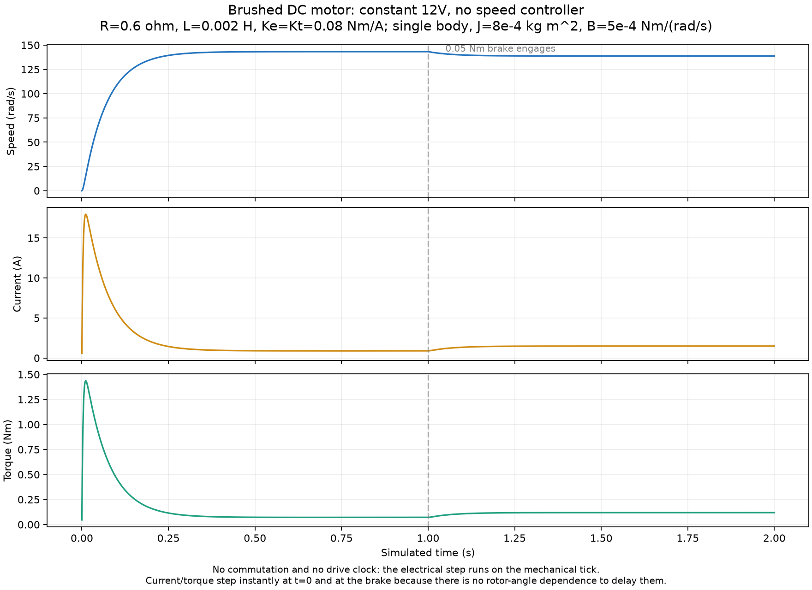

# Brushed DC motor

The simplest of simmy's four motor models. A real brush/commutator pair
keeps the winding facing the magnet always energized the same way, so
unlike every other motor here, torque and back EMF don't depend on rotor
angle at all -- the model collapses to Kirchhoff's voltage law on one
winding, with no commutation and no drive clock of its own:

```
L * dI/dt = V - R*I - Ke*speed
torque = Kt*I
```

`Ke` and `Kt` are the same constant in consistent SI units (`backEmfConstant`),
the same invariant simmy's other permanent-magnet models use.

## API

- `SimmyDcParamsValid` / `SimmyDcInit` / `SimmyDcStep(state, params, voltage,
  speed, dt, &output)` -- backward Euler, held speed over `dt > 0`. Returns
  0 on invalid input and leaves state and output unchanged, the same
  "fail atomically" convention as `SimmyPmStep`.
- `SimmyDcState` carries the instantaneous current plus the same
  cumulative energy ledger (`windingHeatJ`, `inputJ`, `mechanicalWorkJ`,
  `numericalLossJ`) as the PM/BLDC models, so the same balance identity
  holds: `inputJ - mechanicalWorkJ - windingHeatJ - storedMagneticEnergy
  = numericalLossJ`.

## Sample motor

Loads from JSON via `SimmyDcParamsFromJsonFile` -- see
[the motor sections of the config schema](../build.md#motor-sections).

| Parameter | Value |
|---|---:|
| Resistance | 0.6 ohm |
| Inductance | 0.002 H |
| Back-EMF / torque constant | 0.08 (Nm/A == V·s/rad) |

## Measuring Ke from an unloaded generator test

`backEmfConstant` is the one parameter here you're least likely to find
on a datasheet in the units this model wants, but it's also the easiest
to measure directly: spin the motor with nothing else driving its shaft
and nothing drawing current from its terminals, and read the open-circuit
voltage at a known speed. With `I=0` (and so `dI/dt=0` too), the voltage
equation collapses to

```
V = Ke * speed
```

-- the resistance and inductance terms both vanish, so neither needs to
be known yet. The only trap is "nothing drawing current": a voltmeter
with real input impedance pulls a little current through `R`, which
subtracts from `V` and makes the fitted `Ke` read low. A true high-impedance
meter, or an oscilloscope, keeps that error negligible.

Say you spin it at 1259 rpm and read 80V. Convert speed to rad/s first --
this model's `speed` is always rad/s, never rpm:

```
speed = 1259 rpm * (2*pi/60) = 131.84 rad/s
Ke = V / speed = 80 / 131.84 = 0.607 (V*s/rad, i.e. Nm/A)
```

That same number goes straight into `backEmfConstant` for both
`SimmyDcParams.backEmfConstant` and the `dcMotor` JSON field -- `Ke` and
`Kt` are the same constant here, so this one measurement gives you the
torque constant too, not just the back-EMF constant.

## Measured behavior

`examples/dc_motor.c` drives this motor at a constant 12V into a single
body (J=0.0008 kg m^2, B=0.0005 Nm/(rad/s)) with no speed controller, then
engages a 0.05 Nm Coulomb/static brake at 1s:



Current and torque jump the instant voltage or load changes, with no
delay from rotor angle to wait out -- that step response is the RL
charging curve, visible directly in the current trace.

| State | Steady speed | Current | Torque |
|---|---:|---:|---:|
| Unloaded (viscous drag only) | 143.28 rad/s | 0.896 A | 0.0716 Nm |
| 0.05 Nm brake engaged | 138.81 rad/s | 1.493 A | 0.1194 Nm |

Both rows satisfy `current = (voltage - Ke*speed)/resistance` and
`torque = Kt*current` exactly: with ideal commutation, that algebraic
relationship is the whole motor, not an approximation to something
richer underneath. See [examples](../examples.md#brushed-dc) for the
reproduction command.

## Scope

No armature reaction, brush/commutator switching transients, contact
resistance, or mechanical commutation ripple -- the "ideal commutation"
assumption is exactly what makes torque angle-independent here, and
exactly what a real brush motor only approximates. No winding
inductance saturation. `windingHeatJ` is energy dissipated (joules), not
a temperature: there's no thermal mass, cooling, or temperature state,
and so no winding-temperature feedback into resistance either. If you
need the angle-dependent switching detail a commutator actually
produces, that's what the
[BLDC model](bldc.md) is for.
