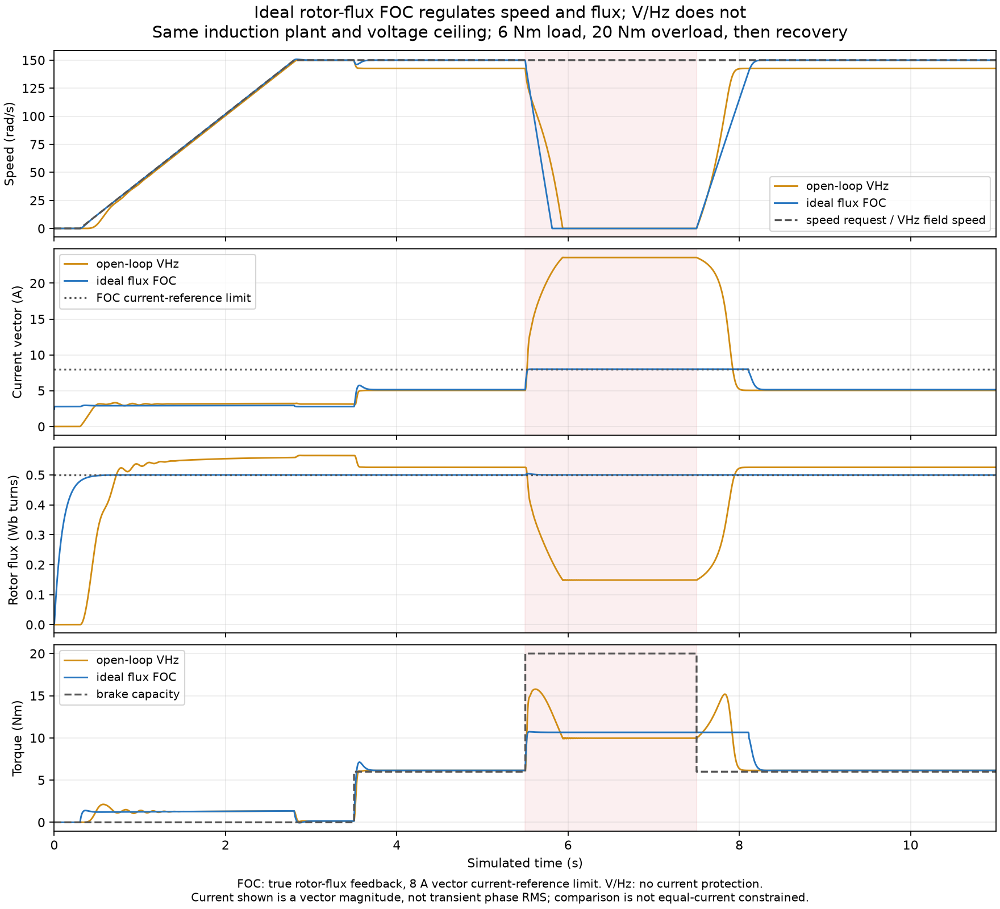
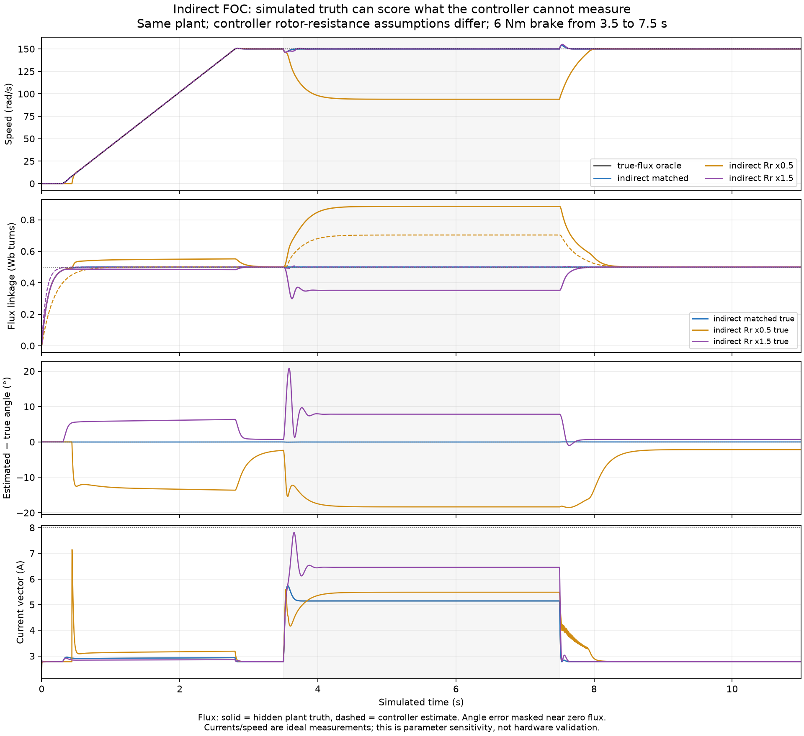
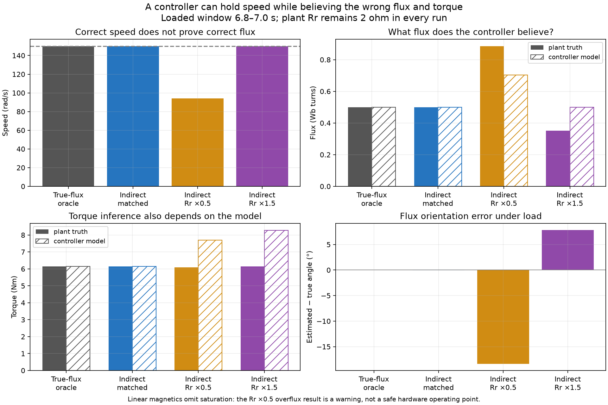

# 3-phase induction motor

A balanced, unsaturated, 3-phase squirrel-cage induction machine in
stationary alpha/beta coordinates, connected to simmy's mechanical
chain. You give it a voltage; it integrates stator and rotor flux and
returns the current and torque that voltage actually produces. Three
drive policies below sit on top of that same plant, each choosing a
different voltage.

This is the *asynchronous* family: rotor current comes from slip, not a
permanent magnet. If you're after a 3-phase permanent-magnet motor
(PMSM) instead, that's the [BLDC/PM page](bldc.md)'s model with
`waveform` set to sine rather than trapezoidal -- "BLDC" there is the
commutation family, not a requirement that the drive be six-step.

The plant is deliberately separate from the drive: three drive modes
below share the same motor physics underneath.

## Equations

Amplitude-invariant Clarke coordinates (alpha = phase A):

```
a = alpha
b = -alpha/2 + sqrt(3)*beta/2
c = -alpha/2 - sqrt(3)*beta/2
```

A balanced sine vector's magnitude is phase peak, not phase RMS. All
rotor electrical parameters are referred to the stator. With
`Ls=Lls+Lm`, `Lr=Llr+Lm`, `Delta=Ls*Lr-Lm^2`:

```
is = (Lr*psi_s - Lm*psi_r)/Delta
ir = (Ls*psi_r - Lm*psi_s)/Delta

d(psi_s)/dt = vs - Rs*is
d(psi_r_alpha)/dt = -Rr*ir_alpha - p*omega*psi_r_beta
d(psi_r_beta)/dt  = -Rr*ir_beta  + p*omega*psi_r_alpha

torque = (3/2)*p*(psi_s_alpha*is_beta - psi_s_beta*is_alpha)
```

`p` is pole pairs. Slip frequency is `fdrive - p*omega/(2*pi)`; nonzero
slip under load is normal, unlike stepper loss of synchronism.

## API

- `SimmyInductionParamsValid` / `SimmyInductionState` / `SimmyInductionEvaluate`
  -- validate coefficients, four stator/rotor flux-linkage states, actual
  currents/torque/stored magnetic energy.
- `SimmyInductionStep` -- electrical RK4 with held voltage and mechanical
  speed; returns RK-weighted interval-average torque.
- `SimmyInductionChainStep` / `SimmyChainStepDt` -- drives mechanical body 0
  from average electrical torque; advances mechanics by an explicit
  fraction of the original tick.
- `SimmyVfdCommandStep` / `SimmyVfdVoltageStep` -- open-loop V/Hz drive:
  sampled frequency ramp plus amplitude command, then continuous phase
  advance at the held frequency for a plant integration interval.

No PWM switching, saturation, core losses, current-limit/trip protection,
or DC-bus dynamics anywhere below. Unlike the BLDC/PM models, there's no
built-in heat ledger either -- copper loss is `Rs*|is|^2 + Rr*|ir|^2`,
computable directly from the currents `SimmyInductionEvaluate` already
returns, but nothing accumulates it for you. Either way, there's no
temperature state, thermal mass, or cooling, so no winding-temperature
feedback into resistance.

## Sample motor

Loads from JSON via `SimmyInductionParamsFromJsonFile` -- see
[the motor sections of the config schema](../build.md#motor-sections).

| Parameter | Value |
|---|---:|
| Pole pairs | 2 (four poles) |
| Stator resistance | 3 ohm |
| Referred rotor resistance | 2 ohm |
| Stator / rotor leakage inductance | 0.01 / 0.01 H |
| Magnetizing inductance | 0.18 H |
| Base frequency | 50 Hz |
| Base / max phase-peak voltage | 187.794 V (230 V line-to-line RMS) |
| Inertia | 0.02 kg m^2 |
| Viscous drag | 0.001 Nm/(rad/s) |

## Open-loop V/Hz drive

The V/Hz law ramps frequency, interpolates from a low-frequency boost
intercept to base phase-peak voltage at base frequency, then holds the
slope to a voltage ceiling. It receives no rotor position, speed,
current, or flux feedback.

| State | Mean rotor speed | Slip frequency | Motor torque |
|---|---:|---:|---:|
| Unloaded | 1498.43 rpm | 0.0522 Hz | 0.1569 Nm |
| 6 Nm brake | 1429.52 rpm | 2.3493 Hz | 6.1497 Nm |
| 20 Nm brake | 0 rpm (stalled) | 50 Hz | 9.8763 Nm |

At 5 Hz with a 3 Nm brake, the undriven example stalls; a 10 V phase-peak
boost intercept restores enough flux/torque margin to sustain ~126 rpm.
The unsaturated model cannot prescribe a safe boost setting -- boost
increases flux as well as torque margin.

## Ideal flux FOC benchmark

`examples/induction_foc.h` is an example rotor-flux-oriented controller
on the **same plant**: true simulated rotor flux and actual stator
current/speed feed a 1 kHz speed loop (q-current demand) and 10 kHz
current PI loops (voltage), with the plant integrating at 40 kHz. This is
an ideal-information benchmark, not sensorless control.



| Steady interval | V/Hz speed | FOC speed | V/Hz current | FOC current |
|---|---:|---:|---:|---:|
| Unloaded | 149.843 rad/s | 150.000 rad/s | 3.141 A | 2.780 A |
| 6 Nm | 142.578 rad/s | 150.000 rad/s | 5.046 A | 5.146 A |
| 20 Nm | 0 rad/s (stalled) | 0 rad/s (stalled) | 23.581 A | 8.000 A |

FOC limits its vector-current reference to 8 A; V/Hz has no current
protection, so this is **not an equal-current comparison**. Under the 6
Nm step, FOC briefly dips to 146.135 rad/s before the speed loop restores
150 rad/s. A separate unattainable-350-rad/s request exercises voltage
saturation and anti-windup: actual current briefly reaches ~11.93 A
despite the 8 A reference limit -- a software demand limit is not a
hardware current trip.

## Indirect (encoder-assisted) FOC

`examples/induction_ifoc.h` replaces true rotor-flux feedback with a
scalar flux estimate built from **only stator current and shaft speed**:

```
d(psi_hat)/dt = (Lm_hat*id_measured - psi_hat)/tau_r_hat
omega_slip_hat = (Lm_hat/tau_r_hat)*iq_measured/psi_hat
d(angle_hat)/dt = polePairs_hat*shaftSpeed + omega_slip_hat
```

Startup gating, torque conversion and current control all use estimated
flux, never the hidden plant flux. With the plant's rotor resistance
fixed at 2 ohm, varying the controller's assumption shows why speed
tracking alone doesn't validate the estimator:



| Controller assumption | Speed | True flux | Estimated flux | Flux-angle error |
|---|---:|---:|---:|---:|
| Matched (2 ohm) | 150.00 rad/s | 0.4999 Wb | 0.5000 Wb | -0.02 deg |
| 0.5x (1 ohm) | 93.94 rad/s | 0.8854 Wb | 0.7034 Wb | -18.35 deg |
| 1.5x (3 ohm) | 150.00 rad/s | 0.3519 Wb | 0.5000 Wb | +7.84 deg |

The 1.5x case tracks speed exactly while its flux estimate is off by 42%:
**correct speed does not prove correct flux estimation**. The 0.5x case
overfluxes toward saturation (not modeled) and becomes voltage-limited.



See [examples](../examples.md#induction-3-phase) for reproduction commands.
