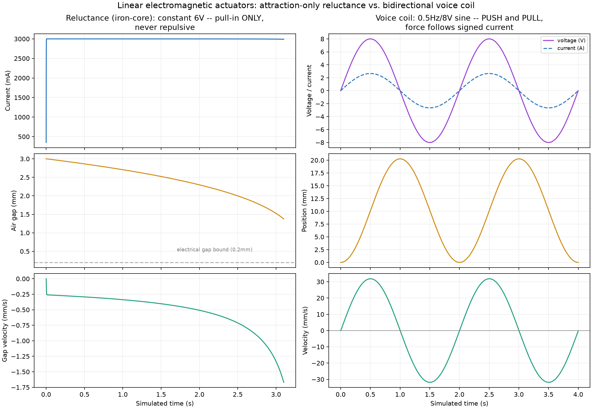
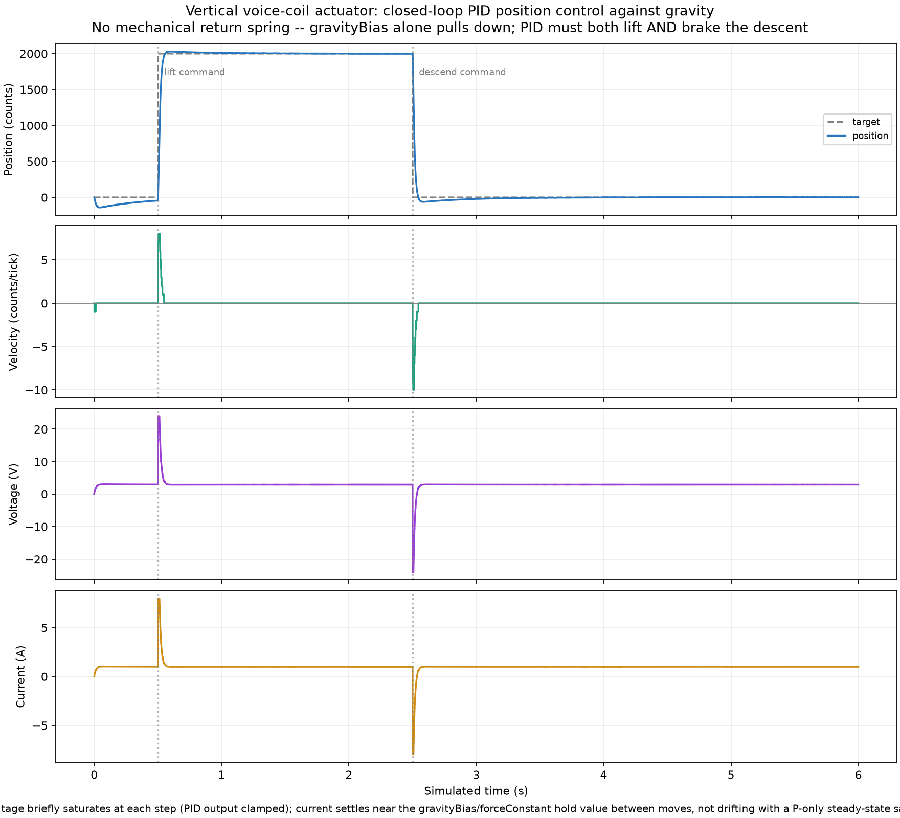

# Linear electromagnetic actuators

Drive a coil with voltage and apply its force to body 0 of the existing
mechanical chain. Two models cover different jobs:

- **Reluctance** (`SimmyReluctance*`) pulls a ferromagnetic armature
  toward a smaller air gap. Force depends on current squared: reversing
  current does not reverse attraction.
- **Voice coil / moving magnet** (`SimmyVoiceCoil*`) pushes or pulls.
  Force follows signed current, so a controller can drive motion in
  either direction.

The electrical parameters, states, and step functions are declared in
`include/simmy_solenoid.h`, included by `include/simmy.h`. The latter
also declares `SimmyLinearMount` and the chain-step wrappers.

## Equations

For reluctance, `x` is the air gap in meters:

```text
L(x) = minInductance + (maxInductance - minInductance) / (1 + x/shapeMeters)^saturationSharpness
F = 0.5 * I^2 * dL/dx
V = R*I + d(L(x)*I)/dt
```

`L` decreases as the gap opens, so `dL/dx <= 0` and force always acts
in the direction of smaller gap. A small `shapeMeters` and a large
`maxInductance/minInductance` ratio give strong gap sensitivity. A large
`shapeMeters` gives little variation over the working travel; near zero
gap, `L` approaches `maxInductance`, not `minInductance`.

Despite its name, `saturationSharpness` shapes only the gap dependence.
The model remains linear in current; it does **not** model iron
saturation as current increases.

For the voice coil:

```text
F = Kf * I
V = R*I + L*dI/dt + Kf*velocity
```

`Kf` is both the force constant (N/A) and the back-EMF constant (V·s/m).
This is the brushed-DC electrical equation in linear units, without a
commutator or a rotary coordinate. `Kf` is constant over the modeled
stroke; field roll-off at the ends of travel is not modeled.

## Preserve flux when the gap moves

Suppose an unpowered, lossless coil has nonzero current and its gap
changes. Flux linkage `psi = L(x)*I` must stay constant. Reusing the new
inductance in both terms of a constant-L current update would instead
hold current constant, inventing or destroying flux.

`SimmyReluctanceState` therefore stores the inductance from the last
step along with the current. Backward Euler on flux linkage gives:

```text
(L_new*I_new - L_old*I_old)/dt = V - R*I_new
I_new = (L_old*I_old + dt*V) / (L_new + dt*R)
```

At a fixed gap, this reduces to the ordinary backward-Euler RL update.
The cost is one extra state field. `SimmyReluctanceInit` starts with zero
current and flux. To seed a nonzero current, also set `state.inductance`
to `SimmyReluctanceInductance(params, initialGap)`.

`tests/test_solenoid.c` checks flux conservation across gap changes,
fixed-gap RL convergence, force direction, chain coupling, and energy
accounting. Both electrical step functions reject invalid input or
unrepresentable results without changing state or output.

## Couple to the mechanical chain

`SimmyLinearMount` supplies three positive conversion factors:

| Field | Meaning |
|---|---|
| `metersPerCount` | Linear travel per chain position count |
| `forcePerNewton` | Chain force units per newton |
| `tickSeconds` | Seconds per mechanical tick |

`SimmyReluctanceChainStep` maps body-0 position to gap and body-0
velocity to gap velocity. Attraction decreases body-0 position.
`SimmyVoiceCoilChainStep` uses body-0 velocity for back EMF; force
follows current sign. Both step the electrical model once, then advance
the chain by `dtSeconds / tickSeconds` ticks. Mechanical substeps do not
recompute the electrical force. Reduce the outer step when coupling is
stiff, especially near a closing reluctance gap.

As with the other motor mounts, callers must supply a valid chain and
mount. The wrappers return 0 without advancing either state if the
electrical step rejects its input, and 1 after a successful step.

**`minGapMeters` is not a mechanical stop.** It bounds electrical gap
calculations only; force uses the inductance derivative evaluated at
that bound even if the body moves past it. Callers must enforce travel
limits separately. Energy accounting below that bound does not describe
a physical contact model.

Load parameters with `SimmyReluctanceParamsFromJsonFile`
(`reluctanceMotor`) or `SimmyVoiceCoilParamsFromJsonFile`
(`voiceCoilMotor`). See [the config schema](../build.md#motor-sections).

## Energy accounting

Both models record input energy, winding heat, mechanical work, and a
numerical energy residual. Winding heat is energy dissipated, not a
predicted temperature.

For a fixed-gap reluctance coil, the numerical residual reduces to the
nonnegative backward-Euler loss `0.5*L*(I_new-I_old)^2`. With a changing
gap it is a **signed residual**, not guaranteed dissipation: it includes
the mismatch between the gap trajectory, supplied velocity, and discrete
force/energy evaluations. A balanced ledger alone is not proof that a
coupled trajectory conserves physical energy. Check step-size convergence
as well.

## Sample motors

These are illustrative parameters, not fits to specific hardware.

| Parameter | Iron-core-like, strong gap sensitivity | Open-core-like, weak gap sensitivity |
|---|---:|---:|
| Resistance | 2.0 ohm | 2.0 ohm |
| `minInductance` | 0.5 mH | 0.5 mH |
| `maxInductance` | 50 mH | 1.5 mH |
| `shapeMeters` | 0.5 mm | 20 mm |
| `saturationSharpness` | 2.0 | 1.0 |
| `minGapMeters` | 0.2 mm | 0.2 mm |

Over a 0.3–3 mm travel, the near/far inductance ratio is about 13 for
the first sample and 1.08 for the second, using the same curve.

The voice-coil sample uses 3 ohm resistance, 0.6 mH inductance, and a
1.2 N/A force constant.

## Open-loop motion

`examples/solenoid_actuators.c` drives a reluctance actuator at constant
6 V and a voice coil with a 0.5 Hz, 8 V sine wave. The first pulls toward
smaller gap; the second pushes and pulls.



## Position control against gravity

`examples/voicecoil_pid.c` drives a vertical voice coil in voltage mode,
with no mechanical return spring. A PID controller lifts the body and
then returns it to the lower target. Integral action cancels the constant
`gravityBias` load without steady-state position sag; back-calculation
limits integral windup when the voltage saturates. The holding current
approaches 1 A at either target.



Descent is controlled rather than free fall: the controller reduces or
reverses force to start downward motion, then applies upward force to
brake it. `tests/test_voicecoil_pid.c` compares the controlled descent
with an identical plant left at zero voltage. The test and example share
`examples/voicecoil_pid_experiment.h`.

See [examples](../examples.md#solenoid--linear-actuators) for commands to
run both demonstrations and reproduce the plots.

## Limits

These are single-coil, single-armature models. They do not include
interactions between separate permanent magnets, current-dependent iron
saturation, hysteresis, eddy-current/core loss, or detailed field
geometry. The voice-coil model assumes a uniform working field throughout
the stroke. Neither model supplies mechanical endstops or thermal dynamics.
