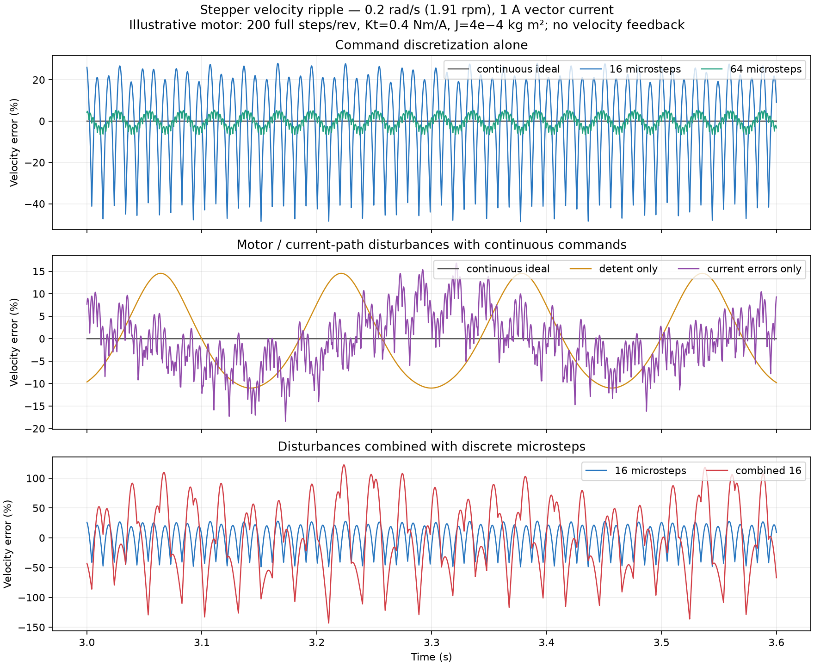

# Stepper motor

A two-phase stepper runs open-loop: you command a microstep angle, and
the motor either keeps up or it doesn't. This model answers the second
question -- how far does real velocity drift from the commanded rate,
and why -- for a current-driven motor. Give it a current and a rotor
angle and it returns torque; it has no winding inductance, no chopper,
and so no opinion about the high-speed torque envelope a real driver's
current loop would start to run into.

## API

Three independently composable pieces, plus a chain driver:

- `SimmyStepperMicrostepAngle(index, M)` takes a signed step/dir index
  and returns an electrical command angle, with `M` microsteps per full
  step. Four full steps make one electrical revolution. The angle wraps;
  the rotor doesn't.
- `SimmyStepperCurrents(phi, peakCurrent, &path, currents)` turns a
  command angle into sine/cosine reference currents, with per-phase DAC
  quantization, fractional gain error, and additive offset each
  independently switchable off. A zeroed `SimmyStepperCurrentParams`
  gives you the ideal case. Quantization happens before gain and offset,
  and nothing clamps the result.
- `SimmyStepperTorque(&motor, theta, Ia, Ib)` turns actual phase currents
  (A) and mechanical rotor angle (rad) into torque (Nm):

```
thetaE = electricalCyclesPerRev * theta + electricalOffset
torque = Kt * (-Ia*sin(thetaE) + Ib*cos(thetaE))
         - detentAmplitude * sin(detentCyclesPerRev*theta + detentPhase)
```

  For currents `(I*cos(phi), I*sin(phi))` the powered term reduces to
  `Kt*I*sin(phi-thetaE)`: a positive displacement from alignment pulls
  back toward it. `I` here is vector peak current -- check your
  datasheet's holding-torque convention before fitting `Kt` to it, since
  datasheets often give per-phase RMS instead. Detent has its own period,
  which you supply rather than infer from the step count, and it
  persists even with zero current, unlike the powered term.
- `SimmyStepperChainStep` applies that torque to body 0 and reevaluates
  it from rotor position at every mechanical substep, holding the
  commanded current fixed across the outer tick.

## Sample motor

A conventional 1.8-degree motor -- 50 electrical cycles per revolution,
not 200 -- used throughout the examples and tests. These parameters load
from JSON too (`SimmyStepperParamsFromJsonFile` /
`SimmyStepperCurrentParamsFromJsonFile`, see
[the motor sections of the config schema](../build.md#motor-sections)):

| Parameter | Value |
|---|---:|
| Full steps / rev | 200 |
| Electrical cycles / rev | 50 |
| Vector peak current | 1 A |
| Torque constant `Kt` | 0.4 Nm/A |
| Rotor + reflected load inertia `J` | 4e-4 kg m^2 |
| Viscous drag `B` | 0.008 Nm/(rad/s) |
| Load torque | 0.03 Nm |
| Detent amplitude | 0.012 Nm @ 200 cycles/rev |
| Current gain error | +3% / -3% |
| Current offset error | +0.01 A / -0.015 A |
| DAC increment | 1/31 A |

## Units

The motor works in SI; the chain works in counts/tick. You bridge them
with explicit `radiansPerCount` and `forcePerNm` factors. With `C`
counts/radian, tick duration `dt` seconds, and chain force unit Nm
(`forcePerNm=1`):

```
position = C * theta            velocity = C * dt * omega
body.inertia = J / (C * dt^2)   body.friction = B / (C * dt)
radiansPerCount = 1 / C         body.gravityBias = load torque in Nm
```

`J` is kg m^2, `B` is Nm/(rad/s). The chain's stiction velocity threshold
stays in counts/tick, so choosing that scale deliberately matters:
resolve the magnetic/mechanical resonance **and** the command pulse
timing, since adding mechanical substeps cannot recover a pulse edge that
an outer tick already hid.

## Measured behavior



Command a constant 0.2 rad/s (1.91 rpm) with no velocity controller and
measure RMS velocity error over a 2-4 s window:

| Scenario | RMS error / target |
|---|---:|
| Continuous ideal | 0.004% |
| 16 microsteps | 20.45% |
| 64 microsteps | 3.04% |
| Detent only, continuous command | 8.83% |
| Current errors only, continuous command | 6.08% |
| Combined, 16 microsteps | 59.17% |

The combined case reverses briefly even though its average speed stays
positive: this is a lightly damped illustrative setup, and these numbers
describe it, not a typical motor.

A 121-point speed sweep from .01 to 1.2 rad/s locates the small-signal
resonance (~35.5 Hz) against three excitation fundamentals -- the
64-microstep and 16-microstep update rates, and the 200-cycle/rev
detent. A compensation experiment adds feedforward detent cancellation
and active damping, cutting combined RMS error roughly tenfold, while
showing that a detent table alone leaves the microstep resonance
untouched: the two disturbances need different fixes. See
[examples](../examples.md#stepper) for reproduction commands and the
full sweep/compensation plots.

## Scope

This model stays low-speed and current-driven, with ideal collocated
rotor feedback in the compensation experiment -- a best case for the
controller, not a claim about what a production control loop achieves.
