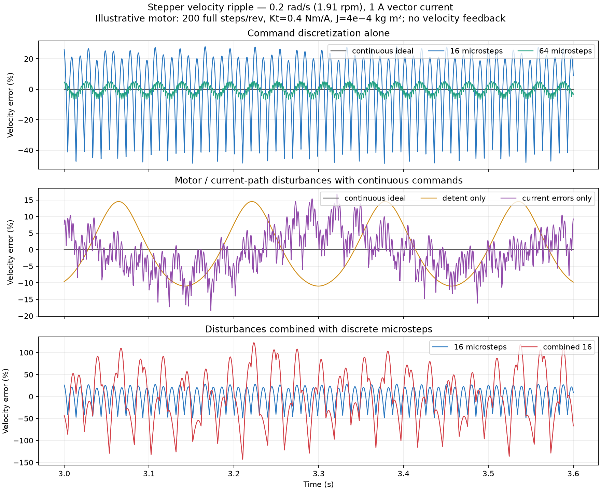

# Working notes: constant velocity is not the same as accurate step counting

These are research/blog notes, not a finished post or a motor specification.
The baseline implementation was committed as `9eaf32c`. All numbers below
come from the accompanying illustrative simulation, not measurements.

## Possible titles / central claim

- **A stepper can count every step and still move terribly**
- **Microsteps, magnetic springs, and the difference between speed and smoothness**
- **Why a cogging table does not fix every kind of motor ripple**

The useful story is not “steppers are bad.” It is that position-periodic
motor disturbances, discretized excitation, and resonance are different
mechanisms. They call for different remedies. Average speed and nominal
microstep resolution alone do not describe motion quality.

## 1. Start with the electromechanical distinction


**The commanded field is not the rotor.** Advancing the command changes
phase-current references. The rotor remains an independent mechanical
state, accelerating under torque, load, inertia, and friction. The
encoder observes rotor motion, not the commanded field angle.

This separation was present in the first model; it does not require a
second rigid body. A second mechanical body would represent something
else: a load or shaft separated from the rotor by mechanical compliance.
We deliberately keep the current experiment mechanically rigid and the
stator grounded. The apparent spring in these plots is magnetic.

The low-speed motor equations, with positive mechanical angle theta:

```
thetaE = N * theta + theta0
Ia* = I * cos(phi)                 Ib* = I * sin(phi)
tau = Kt*(-Ia*sin(thetaE) + Ib*cos(thetaE))
      - Ad*sin(Nd*theta + psi)
J * domega/dt = tau - B*omega - load
```

With ideal currents the powered torque reduces to
`Kt*I*sin(phi-thetaE)`. Near equilibrium its mechanical stiffness is
`Kt*I*N*cos(loadAngle)`. This is enough to produce load angle, ringing,
resonance, and potentially loss of synchronism without assigning rotor
position directly. Four full steps make one electrical revolution;
a 200-full-step/rev motor has N=50, not 200.

## 2. Show the baseline before promising compensation



Suggested caption: *Same nominal speed, different motion. Ideal continuous
currents, discrete microsteps, detent torque, and phase-current errors
produce very different rotor velocities. None of these curves is a
controller output masquerading as position.*


The speed sweep makes the mechanism clearer than a single point:

- The local small-signal resonance is about 35.5 Hz for this motor/load.
- A 64-microstep command reaches that fundamental near .0174 rad/s.
- A 16-microstep command reaches it near .0698 rad/s.
- The detent fundamental reaches it near 1.116 rad/s.
- Harmonics of the staircase can excite the same mode at lower speeds.
- More microsteps reduce excitation but also move its fundamental
  crossing to a lower mechanical speed. Do not extrapolate one speed's
  result to all operating conditions.
- The absolute-error panel matters: normalization by a tiny target can
  make low-speed errors look enormous even without a local resonance peak.

A rotor can oscillate backward and forward **inside the same magnetic
potential well**. No default sweep run crossed +/- pi unwrapped electrical
load angle, yet some spent nearly half their time moving backward. That
is not contradictory, nor is it proof of missing steps. The +/- pi flag
is a coarse phase-well warning, not a rigorous pull-out criterion or the
exact loaded potential-energy separatrix.


The spectrum is useful supporting material, but probably not the lead
figure. Spatial disturbances become temporal excitations as speed changes.
The broad tails/jagged tiny features in this numerical spectrum should
not be sold as measured electromagnetic phenomena.

## 3. Compensation experiment: a controlled ablation

Three plants, four current-domain policies, no command smoothing:

| Plant scenario | Command | Disturbances |
|---|---|---|
| Detent only | Continuous sine/cosine reference | Detent torque |
| Microsteps only | 16 microsteps/full step | Command staircase only |
| Combined | 16 microsteps/full step | Detent + current-path errors |

Policies:

1. **None:** unchanged phase-current references.
2. **Detent feedforward:** cancel the estimated position-only torque.
3. **Active damping:** oppose deviations from target rotor velocity.
4. **Both:** sum the two corrections.

The feedforward estimate is supplied explicitly by the experiment. It is
an **exact sinusoidal detent map**, a best-case proxy for a measured
position-indexed torque table, not a table identified by this work.
The microstep-only ablation has no detent and uses a zero table.

```
tauCorrection = Aestimate*sin(Nestimate*theta + phaseEstimate)
                - D*(omega - targetOmega)
IaReference = cos(phi) - (tauCorrection/Kt)*sin(thetaE)
IbReference = sin(phi) + (tauCorrection/Kt)*cos(thetaE)
```

The rotor-frame tangential current produces the desired incremental
torque for the ideal sine-law motor. **It is not a mechanical-force
shortcut.** References go through the same DAC quantization, phase gains,
and offsets as the baseline. Correction is limited to +/- .2 Nm and
actual phase currents to +/- 1.5 A. D=.08 Nm/(rad/s). The current errors
are not inverted or secretly removed by the compensator.

This requires access to phase-current references, or an equivalent vector
current/phase interface; an external STEP/DIR-only interface cannot
necessarily implement it. Feedback is ideal, instantaneous motor-side
angle and velocity, sampled once per outer tick. There is no encoder
quantization, velocity estimator, feedback filtering, or transport delay.
That makes damping a deliberately optimistic benchmark, not production
controller validation. Position feedforward also needs a rotor angle
estimate; evaluating its table at command angle instead is a different,
untested approximation.

## 4. Results worth discussing


Suggested caption: *A detent table addresses a position-only disturbance;
active damping suppresses resonant amplification. Neither automatically
turns staircase excitation into uniform rotation.*

RMS velocity error as a percentage of target, using whole-electrical-cycle
measurement windows:

| Scenario and speed | None | Detent FF | Damping | Both |
|---|---:|---:|---:|---:|
| Detent only, 1.107971 rad/s | 80.86% | 1.00% | 8.68% | 0.092% |
| 16 microsteps, .0698 rad/s | 1513.02% | 1513.02% | 150.16% | 150.16% |
| Combined, .2 rad/s | 59.46% | 46.99% | 22.40% | 18.87% |

The enormous relative error in the microstep-resonance row corresponds
to 1.056 rad/s absolute RMS error, reduced to .105 rad/s by damping.
The target there is only .0698 rad/s. Damping gives a roughly tenfold
improvement, **but the result still reverses**: the backward-motion
fraction falls from 49.4% to 42.8%. It would be misleading to call this
“fixed.” The command staircase remains present.

At .2 rad/s in the combined case, backward-motion time drops from 4.62%
without correction to zero with either damping or both, over the measured
window. Detent feedforward alone leaves 1.77% backward-motion time.

Feedforward is not guaranteed to improve every combined run: at the
sampled .06787 rad/s point, combined absolute RMS error is .882 rad/s
without compensation and .987 rad/s with detent feedforward alone.
Changing one disturbance can change nonlinear interactions with another.
Do not claim a universal benefit from the .2 rad/s result.


Suggested caption: *Three different problems, four policies. The microstep
resonance retains backward motion after damping, despite a tenfold RMS
improvement. At .2 rad/s the combined case benefits from both mechanisms.*

Across the 732-run compensation sweep, peak actual phase current is at
most 1.04 A, vector-current RMS at most 1.00345 A, and neither configured
actuator limit is reached. The CSV records current effort and both limit
fractions rather than assuming unlimited actuation. This is **not** a
thermal or drive-power analysis: winding losses, supply limits, current
bandwidth, and copper heating are not simulated.

## 5. Numerical checks — avoid turning simulation details into a story

The model recomputes torque from rotor position at every mechanical
substep. Currents, commands, and compensation are held over the outer
tick. Nominal settings: 10 kHz outer ticks, 20 mechanical substeps/tick.

Targeted checks at 20 kHz:

| Case | 10 kHz RMS / target | 20 kHz RMS / target |
|---|---:|---:|
| Microstep resonance, no correction | 1513.02% | 1512.98% |
| Microstep resonance, damping | 150.16% | 150.09% |
| Detent resonance, no correction | 80.864% | 80.866% |
| Detent resonance, damping | 8.684% | 8.685% |
| Detent resonance, exact FF | 0.997% | 0.498% |
| Detent resonance, both | 0.0917% | 0.0458% |

The strong oscillations and damping improvements persist. The small
exact-cancellation residuals scale strongly with update period: the
feedforward current is held, rather than continuously recalculated as
the rotor moves. Doubling Hz changes command/compensation update rate
as well as the mechanical timestep; this is **joint discretization and
sample-rate sensitivity**, not an integration-only check of a fixed-rate
controller. Do not present the tiny residuals as intrinsic motor limits.
Likewise the high-speed off-resonance tails depend on pulse-time
quantization. Mechanical substeps do not recover edges between outer ticks.

`make test` covers the original mechanics, torque law, phase-current
errors, equilibrium, ringing, sweep resonance, metric identities, and
compensation behavior. New compensation checks include zero-policy
baseline equivalence, wrong-table phase worsening ripple, current/torque
saturation, finite metrics, and timestep/update-rate sensitivity.

## 6. Assumptions to retain in any eventual article

- Illustrative parameters, no specific motor calibration or validation.
- Kt=.4 Nm/A, I=1 A **vector peak**, N=50, J=4e-4 kg m² including
  reflected load, B=.008 Nm/(rad/s), constant load=.03 Nm.
- Detent=.012 Nm, 200 cycles/rev, phase=.3 rad; independent of N.
- Combined drive: +3%/-3% gain error, +.01/-.015 A offsets,
  1/31 A quantization increments, quantization before gain/offset.
- Mechanically rigid rotor/load; grounded stator. Rotor and commanded
  magnetic field are **not** rigidly tied together.
- Independent equilibrium starts, not ramps from rest or proof of
  pull-in/pull-out performance. Two seconds settling for each run.
- Baseline sweep: 121 log-spaced points. Compensation sweep: 61 points,
  same .01..1.2 rad/s interval. Lines connect sampled trials; maxima are
  not optimized and narrow peaks might lie between samples.
- Sweep windows span at least two seconds and four electrical cycles,
  rounded to whole cycles. Trace figures use the original 2–4 s window.
  That is why combined baseline is 59.46% in the compensation point table
  but 59.17% in the first trace experiment. It is not a model change.
- Ideal motor-side feedback and exact detent knowledge are best cases.
- No non-sinusoidal phase torque, winding inductance/back-EMF, chopper,
  supply/current-regulator dynamics, saturation magnetics, or thermal model.
- Command smoothing/interpolation was **not** tested in this comparison.

## 7. Actual slips at the start and stop ends


Suggested caption: *The same torque law can fail to pull in at startup,
or fail to capture the original magnetic well after an abrupt stop.
Both settle to valid wrapped electrical alignment, but at the wrong
unwrapped mechanical position. No missed steps are scripted into the model.*

The new `tests/test_stepper_moves.c` regression fixture separates these
transients from the steady-speed sweeps. It uses the same J, B, Kt, N,
1 A vector current and 16-microstep excitation, but **no load, detent,
or current errors**, so the settled equilibrium has an unambiguous
integer electrical-cycle position offset. Start tests begin at rest.
Isolated stop tests begin on the ideal synchronized traveling solution:
`theta=-asin(B*omega/(Kt*I))/N`, command angle zero, actual velocity omega.
They deliberately avoid conflating a startup error with stopping behavior.

| Forward-direction test | Command / initial condition | Settled rotor-minus-command error |
|---|---|---:|
| Slow start + hold | 128 microsteps at .2 rad/s from rest | 0 electrical cycles |
| Fast start + hold | 1024 microsteps at 20 rad/s from rest | -16 cycles / -64 full steps |
| Gentle isolated stop | Freeze field, initial speed .2 rad/s | 0 electrical cycles |
| Hard isolated stop | Freeze field, initial speed 20 rad/s | +5 cycles / +20 full steps |

Reverse-direction tests produce sign-mirrored errors. The slow start's
maximum lag is only .016 electrical cycles; the fast start accumulates
over 15 cycles of lag while pulses are still being issued. The exact
finite pulse count is asserted. After the final pulse the command index
is frozen and phase currents remain energized for two simulated seconds.
The low-speed stopping cases demonstrate overshoot and reversal before
settling rather than an instantaneous velocity reset.

Assertions require near-zero settled velocity and a stable integer-cycle
alignment, then separately distinguish the intended well from a wrong
well using **unwrapped** position. The fast-start and hard-stop final
well counts persist when halving the outer timestep from 100 to 50 us,
in both directions. These are direct model tests of slipping and
recapture, not merely the earlier +/- pi excursion warning.

Important scope boundary: 20 rad/s is a deliberately severe ideal-current
test, not a measured startup threshold. The model still omits winding
inductance, back-EMF, voltage/current bandwidth, and the ability of a real
driver to sustain 1 A at that speed. These regressions establish that
loss of synchronism and wrong-well recapture are possible in this
implementation; they do not validate a hardware pull-in/pull-out curve.
The earlier independent equilibrium-started sweeps remain steady-state
experiments, not tests of these transients.

Reproduce without running the large sweeps:

```sh
make test
build/test_stepper_moves --csv build/stepper_moves.csv
python3 examples/plot_stepper_moves.py build/stepper_moves.csv docs/plots/stepper_start_stop_slip
```

## 8. Publication outline / follow-up questions

1. Open with average speed looking correct while the rotor reverses.
2. Explain the magnetic spring and why microsteps do not assign position.
3. Sweep speed; connect excitation frequency to the one mechanical mode.
4. Separate detent, current errors, and command discretization.
5. Compare a torque map and damping; show both success and remaining errors.
6. Close with what the model does not establish and measurements needed.

Before claiming applicability to hardware:

- Measure a rotor-angle-indexed disturbance map at several currents/loads.
- Test feedforward map amplitude/phase error, not just the exact table.
  There is a wrong-phase regression test, but no published sensitivity
  sweep yet.
- Add encoder quantization, velocity estimation, latency, and noise.
- Preserve a fixed controller update rate while refining mechanics and
  pulse-event timing independently.
- Compare driver-side interpolation/command smoothing to damping at the
  stubborn low-speed microstep resonance.
- Add measured current tracking if operating speed requires it.

## Artifacts and reproduction

All figures linked above are retained in `docs/plots/` as PNG and SVG.
They survive `make clean`. Small summary CSVs, including the point and
20 kHz comparisons, are retained in `docs/data/`. Large raw time traces
remain generated artifacts under `build/`, not versioned data.

From the repository root (NumPy/Matplotlib are plotting-only; the optional
parallel runner uses just Python's standard library):

```sh
make test examples

# Baselines: default concurrency permits all 121 independent trials.
# Previously measured: about 20 seconds with --jobs 8.
build/stepper_velocity > build/stepper_velocity.csv
python3 examples/run_stepper_sweep.py velocity --output build/stepper_sweep.csv
python3 examples/plot_stepper.py build/stepper_velocity.csv docs/plots/stepper
python3 examples/plot_stepper_sweep.py build/stepper_sweep.csv docs/plots/stepper_sweep

# Compensation: default concurrency permits all 61 independent trials.
# Previously measured: about 22 seconds with --jobs 8.
python3 examples/run_stepper_sweep.py compensation --output build/stepper_compensation_sweep.csv
build/stepper_compensation --trace detent 1.107971 > build/stepper_compensation_detent_trace.csv
build/stepper_compensation --trace microsteps .0698 > build/stepper_compensation_microsteps_trace.csv
build/stepper_compensation --trace combined .2 > build/stepper_compensation_combined_trace.csv
python3 examples/plot_stepper_compensation.py build docs/plots

# Point comparisons; use 20000 as the last argument for the finer update rate.
build/stepper_compensation --point .2
build/stepper_compensation --point .0698 10000
build/stepper_compensation --point .0698 20000
build/stepper_compensation --point 1.107971 10000
build/stepper_compensation --point 1.107971 20000
```

The serial C `--sweep` commands remain available without Python. Each
speed trial has fresh mechanical, command, and RNG state. Parallelism is
across speeds (not integration steps); a thread pool supervises independent
C processes, with no shared simulation state or Python GIL bottleneck.
The runner merges completed trials into deterministic speed order and
only publishes output after every trial succeeds. `--output` uses atomic
replacement, preserving an existing CSV on failure. Set `--jobs` to suit
the machine; the default permits 256 workers, limited only by the number
of trials rather than CPU count. With the default grids this launches up
to 61 compensation or 121 baseline trials concurrently, deliberately
allowing CPU overcommit because per-trial memory usage is small.

These are **offline, fixed-timestep simulations**, not real-time tasks.
Within a trial, each outer tick advances simulated time by `1/HZ`, and
mechanical integration uses 20 fixed substeps. There is no sleep, deadline,
wall-clock-derived timestep, or skipped integration step when a process
is descheduled. Scheduling affects completion time only. In that sense
each trial is deterministic/step-driven; there is **no cross-trial
lockstep barrier** requiring one process to wait for another at tick N.

On this development host the compensation sweep took 142 seconds serial
versus 22 seconds with eight workers; baseline sweep 134 seconds versus
20 seconds. Both parallel CSVs were **byte-for-byte identical** to the
archived serial results. With the new 256-worker default (61 independent
trials available), the compensation sweep took 19.3 seconds, also with
byte-for-byte identical output. These timings are host-dependent, not
performance guarantees. Nine optional `make test-tools` tests cover the overcommit
default, trial-count worker limit, actual overlap
with out-of-order completion, deterministic merging, malformed/inconsistent
CSV, worker failure, atomic output, and argument validation. The C-only
physics suite does not acquire a Python dependency.

Figure inventory, in likely article order:

1. `stepper_electromechanical_separation` — conceptual command/rotor distinction.
2. `stepper_velocity` — isolate individual disturbances at one speed.
3. `stepper_sweep` — resonance and the weakness of mean-speed metrics.
4. `stepper_compensation_sweep` — different remedies address different mechanisms.
5. `stepper_compensation_traces` — show remaining reversals, not only RMS wins.
6. `stepper_spectrum` — optional supporting detail / appendix.
7. `stepper_start_stop_slip` — persistent wrong-well capture at both ends;
   use to distinguish step loss from the bounded ripple in the main sweeps.
